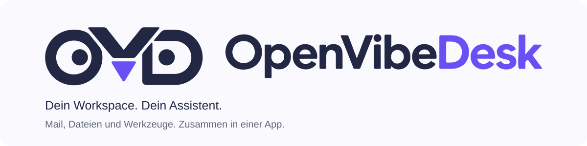

# OpenVibeDesk



**Ein Desktop-Workspace, den du per Oberfläche und Assistent bedienen kannst.**

OpenVibeDesk verbindet Chat, Mail, Dateien und eigene Integrationen in einer lokalen Desktop-App. Der Assistent kann Informationen abrufen und die passenden Fenster steuern: zum Beispiel eine Mail suchen, sie im Mailfenster öffnen und einen Entwurf an ihren Absender vorbereiten. Oberfläche und Assistent verwenden dafür dieselben validierten Funktionen.

Das Projekt ist eine frühe Entwicklungsfassung für eine einzelne Person. Die Entwicklung und praktische Nutzung wurden unter **macOS** erprobt. Windows und Linux sind als Buildziele angelegt; breitere Plattform- und Installationsprüfungen stehen noch aus.

## Was bereits funktioniert

| Bereich | Aktueller Umfang |
| --- | --- |
| **Assistant** | Streaming, Markdown, Chatverwaltung, Abzweigungen, Mail-/Chat-/Dateireferenzen, Zeit- und Rechenwerkzeuge sowie ein konfigurierbarer Agentenlauf. |
| **Mail** | IMAP-Konten, Ordner, Serversuche, kombinierbare Filter und Zählungen, Textansicht, Anhänge, lokale Entwürfe und SMTP-Versand. |
| **Dateien** | Ordnernavigation mit Pfadleiste, Filter und Sortierung, Textvorschau, Drag & Drop in den Chat und Anhänge für Mailentwürfe. |
| **MCP** | Lokale Server über Stdio und entfernte Server über Streamable HTTP, gezielte Werkzeugfreigaben und ein kompaktes Aktivitätsprotokoll. |

Mail, Chat, Dateien und Einstellungen öffnen sich als eigene Fenster. Das Dock und seine Reihenfolge lassen sich anpassen. In den Einstellungen bleiben zusammengehörige Optionen kompakt gruppiert und über die globale Suche auffindbar.

## Lokal starten

Voraussetzungen: **Node.js 22.13 oder neuer** und **pnpm 11.25.0**. Beide Befehle müssen im Terminal verfügbar sein.

Im Projektordner:

```sh
pnpm install --frozen-lockfile
pnpm dev
```

`pnpm dev` baut das Projekt und startet Electron direkt. Eine Installation der App ist dafür nicht nötig.

1. Unter **Einstellungen → KI & Verbindung** einen OpenAI-kompatiblen Endpunkt und bei Bedarf einen API-Schlüssel hinterlegen. Der Endpunkt muss Streaming unterstützen; für Workspace-Aktionen wird außerdem Tool-Calling benötigt.
2. Ein intelligentes und ein einfaches Modell auswählen. Der Chat verwendet je Modell die gespeicherte Thinking-Stufe, soweit der Anbieter sie unterstützt.
3. Optionale Module unter **Einstellungen → Module** verwalten. Mailkonten werden unter **E-Mail** eingerichtet; IMAP und SMTP stehen pro Konto zusammen. MCP-Server werden unter **MCP** gespeichert, verbunden und anschließend für einzelne Werkzeuge freigegeben.

Für einen lokalen Modellserver ist HTTP auf Loopback-Adressen möglich. Entfernte KI-Endpunkte benötigen HTTPS. Die Workspace-Werkzeuge lassen sich ausschalten, wenn der gewählte Endpunkt kein Tool-Calling unterstützt.

Weitere lokale Befehle:

```sh
pnpm typecheck
pnpm build
pnpm pack:mac
```

Die Paketbefehle `pack:mac`, `pack:win` und `pack:linux` erzeugen DMG-, NSIS- beziehungsweise AppImage-Artefakte unter `release/`. Signierung und eine vollständig geprüfte Release-Verteilung stehen noch aus. Funktionen prüfen wir zunächst praktisch; gezielte vorhandene Tests können mit `pnpm test` ausgeführt werden.

## Module und schlanker KI-Kontext

Der **Assistant ist das Pflichtmodul** `ovd-assistant`. Mail (`ovd-mail`), Dateien (`ovd-files`) und MCP (`ovd-mcp`) liegen als optionale Module mit eigener Fachlogik, Oberfläche und Registrierung im Repository.

Der Assistent bekommt anfangs kurze Modulbeschreibungen und zwei Entdeckungswerkzeuge:

1. `find_modules` findet passende Module für den Auftrag.
2. `get_module_tools` lädt gezielt deren benötigte Funktionen. Erst danach wird das Fachwerkzeug aufgerufen.

So wächst der anfängliche Kontext nicht mit jedem vollständigen Werkzeugkatalog. Referenzen enthalten eine stabile ID und eine begrenzte Momentaufnahme; weitere Inhalte werden bei Bedarf gezielt nachgeladen.

Eigene Modulordner werden beim Start aus dem OVD-Benutzerdatenordner erkannt. Unter macOS liegt er derzeit in `~/Library/Application Support/ai-workspace/`. Fremdmodule benötigen die Freigabe ihres konkreten Dateistands. Verbundene MCP-Server mit freigegebenen Werkzeugen nutzen dieselbe Modulsuche.

Einstiegspunkte: [Modulvertrag](CONTRIBUTING.md#eigene-module), [Notizmodul als Beispiel](examples/notes-module/README.md), [MCP-Modul](modules/ovd-mcp/README.md) und [MCP-Beispielserver](examples/mcp-server/README.md).

## Daten und aktueller Stand

- **Lokal gespeichert:** Einstellungen, Entwürfe und Chats bleiben auf dem Rechner. Die lokale Chat-/Workspace-Datenbank ist derzeit **nicht verschlüsselt**. API-Schlüssel, Mailpasswörter und MCP-Geheimnisse liegen im Zugangsdaten-Speicher des Betriebssystems.
- **KI-Anbieter:** Nachrichten, ausgewählte Referenzen und angeforderte Werkzeugergebnisse werden an den konfigurierten Anbieter gesendet. Eine lokale Desktop-App bedeutet nicht automatisch ein lokales KI-Modell.
- **Mail:** OAuth, eine HTML-Mailansicht, vollständige Synchronisierung und ein dauerhafter Offline-Cache fehlen noch. Versand nutzt SMTP; eine Serverannahme garantiert weder Zustellung noch eine Ablage im Gesendet-Ordner.
- **Dateien:** UTF-8-Texte bis 2 MiB sind seitenweise lesbar. PDF, Office und andere Binärformate liefern vorerst Metadaten. Dateizugriff ist innerhalb der Betriebssystemrechte frei möglich; Dokumente ist ein Startpunkt, keine Ordnergrenze.
- **Erweiterungen:** MCP-OAuth, Ressourcen, Prompts und der ältere SSE-Transport fehlen noch. Lokale MCP-Server und freigegebene Fremdmodule laufen mit normalen Benutzerrechten und sind keine Betriebssystem-Sandbox.

Versand und andere bestätigungspflichtige Aktionen verwenden den gemeinsamen Freigabeablauf. Der ausdrücklich gespeicherte Modus **„Ohne Abfragen“** kann einzelne Bestätigungen für beauftragte Assistentenaktionen überspringen. Werkzeugrechte und die Freigabe fremden Modulcodes bleiben davon getrennt.

Der interne Paketname `ai-workspace` und bestehende Speicherkennungen bleiben erhalten, damit lokale Daten und Schlüssel weiterverwendet werden können. Technische Details und Grenzen stehen in der [Architektur](docs/architecture.md).

## Nächste Etappen

| Bereich | Stand | Nächster Ausbau |
| --- | --- | --- |
| Desktop & Chat | Nutzbare Grundlage | Bedienung, Barrierefreiheit und Zuverlässigkeit weiter verbessern. |
| Mail | Lesen und Schreiben als Basis vorhanden | OAuth, HTML-Ansicht, Synchronisierung und Offline-Cache. |
| Module & MCP | Gemeinsame Registrierung und gezielter Werkzeugzugriff vorhanden | Modulvertrag weiter erproben; MCP-Ressourcen, Prompts und OAuth ergänzen. |
| Veröffentlichung | Lokale Entwicklung und Buildskripte vorhanden | Plattformprüfungen, signierte Pakete, Datenmigrationen und Updates. |

## Mitwirken

[CONTRIBUTING.md](CONTRIBUTING.md) beschreibt Entwicklung und Modulbeiträge. Die dauerhaften Produktvorgaben stehen im [Settings-Konzept](docs/settings-design.md), [Mail-Leitfaden](docs/mail-design.md) und [Markenleitfaden](docs/brand.md). Die gelieferten CI-Assets liegen unverändert unter [assets/brand](assets/brand/), darunter die [horizontale Kombination](assets/brand/ovd-horizontal-primary.svg) und die [Bildmarke](assets/brand/ovd-symbol-primary.svg).

**Lizenz:** Der Code steht unter [MIT](LICENSE). Für die mitgelieferte Manrope-Schrift gilt die [SIL Open Font License 1.1](assets/brand/fonts/OFL.txt); ihre Herkunft steht in [SOURCE.txt](assets/brand/fonts/SOURCE.txt).
