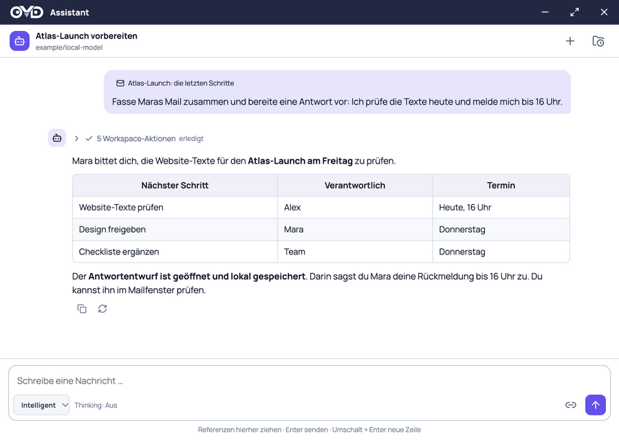
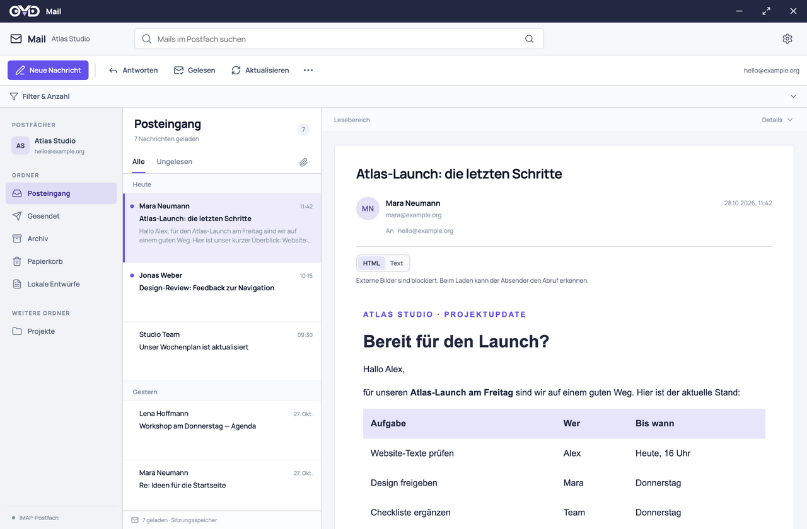
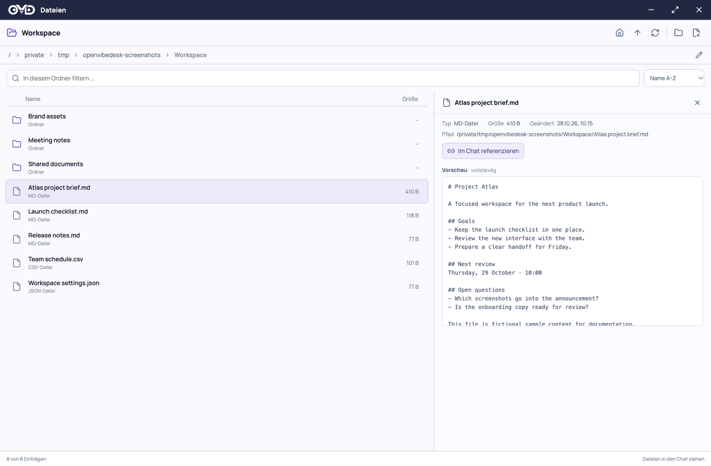
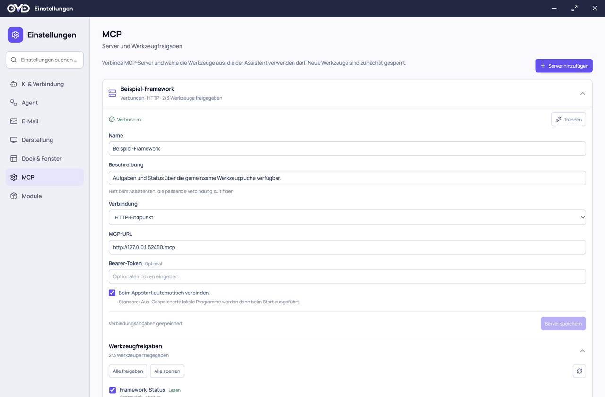
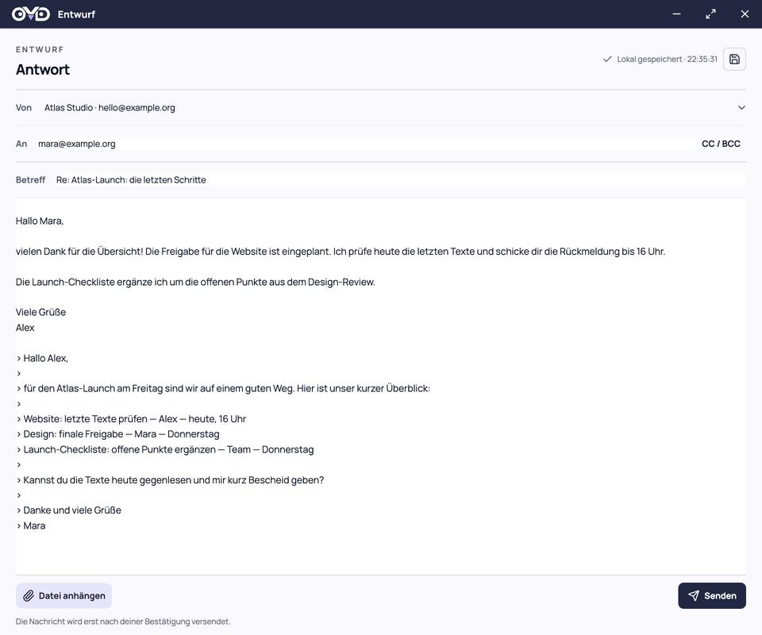
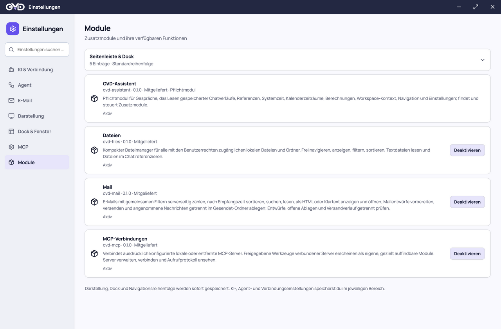

# OpenVibeDesk


**An everyday desktop app with an assistant built in.**

OpenVibeDesk is an open-source project for people who want to get their daily work done. It brings mail, files, and company tools into a local desktop app with familiar windows, buttons, and menus. You can work directly in the interface, ask the assistant for help, and move between the two as needed.

The assistant works with the same app you see. Ask it to find an email, and it can open that message in the mail window. Ask for a reply, and it can prepare an editable draft. The interface and assistant use the same functions, so the conversation connects to visible work you can inspect and continue yourself.

This is an early, single-user development version. Development and practical use have been exercised on **macOS**. Windows and Linux build targets exist; broader platform, installer, and release validation is still pending. The application interface is currently primarily German; this repository's documentation is maintained in English.

[Project goal](#who-we-are-building-this-for) · [Screenshots](#a-look-inside) · [Getting started](docs/getting-started.md) · [Documentation](docs/README.md) · [Maturation plan](docs/maturation-plan.md) · [Contributing and modules](CONTRIBUTING.md) · [Architecture](docs/architecture.md)

## Who we are building this for

Think of a small auto repair shop dealing with customer messages, supplier emails, and the daily inbox backlog. Its staff should be able to find a conversation, understand what needs attention, and prepare a reply through an app they can use without learning how AI agents work. Good defaults, clear windows, and understandable actions matter more than adding another layer of complexity.

Every business has its own tools. An IT service provider or the IT person at a small company should be able to build a module connecting OVD to that company's ERP, for example to look up a customer or an order. That module can provide ordinary controls for staff and the same functions for the assistant. Company-specific integrations can be distributed through private module repositories. ERP access is an example of what a custom module could add; it is not a bundled integration today.

The ambition is a useful app for everyday people and small businesses. It is not a self-learning agent trying to replace every tool or take over the business. We are building for people who need practical help with their work, with familiar controls and an assistant they can call on when useful. Large enterprise deployments and AI power users are not the audience driving the design.

This is the direction of the project. The early version already has Mail, Files, Chat, and module support; making those dependable and approachable for daily use is the next step.

## A look inside

Read a message, bring it into Chat as a reference, and let the Assistant prepare a reply in a separate draft window. Files and approved MCP tools join the same workspace.

These screenshots show the current app with **fictional sample data in isolated profiles**. The interface is currently primarily German. Click any image to view it at full size.

| Assistant | Mail |
| --- | --- |
| [](assets/screenshots/assistant.png) | [](assets/screenshots/mail.png) |
| Reference content, inspect tool activity and prepare the next step through Chat. | Browse folders and messages with HTML/text reading and controlled image loading. |

| Files | MCP connections |
| --- | --- |
| [](assets/screenshots/files.png) | [](assets/screenshots/mcp.png) |
| Navigate local folders, preview supported text and reference files in Chat. | Connect integrations and choose which tools the Assistant may discover and use. [View tool permissions](assets/screenshots/mcp-tools.png). |

| Mail drafts | Settings and modules |
| --- | --- |
| [](assets/screenshots/draft.png) | [](assets/screenshots/settings.png) |
| Review the prepared reply and its save status before sending. | Manage optional modules and workspace preferences in compact categories. |

[Screenshot details and refresh guidance](assets/screenshots/README.md)

## Available features

| Area | Current scope |
| --- | --- |
| **Assistant** | Streaming, Markdown, session management, chat branches, mail/chat/file references, time and calculation tools, and configurable agent execution. |
| **Mail** | Per-account sender names, signatures and retrieval intervals; folders, search/filter/count, HTML/text reading, attachments, local drafts, SMTP sending and separate Sent-copy filing with retry. |
| **Files** | Folder navigation with a path bar, filtering and sorting, text previews, drag-and-drop references in chat, and attachments for mail drafts. |
| **MCP** | Local servers over Stdio and remote servers over Streamable HTTP, individual tool approvals, and a compact activity log. |

Mail, chat, files, and settings open in separate windows. The dock and its module order are configurable. Settings use compact groups and global search.

Modules can signal new activity with a small dot on their Dock and Settings icons: it briefly breathes, then stays visible until acknowledged. The Mail module uses this for newly observed Inbox activity.

## Run locally

Install **Node.js 22.13 or newer** and **pnpm 11.25.0**, then run these commands in a checkout of this repository:

```sh
pnpm install --frozen-lockfile
pnpm dev
```

`pnpm dev` builds the project and launches Electron without installing the app. It does not start a hot-reload server; restart it after source changes. If `pnpm` is missing, see [setup and troubleshooting](docs/getting-started.md#install-the-development-tools).

Configure an OpenAI-compatible endpoint and models in **Settings → AI & connection** (currently **Einstellungen → KI & Verbindung**). Streaming is required; workspace actions also require tool calling. The [first-run guide](docs/getting-started.md#first-run) covers mail accounts, optional modules, and MCP setup.

| Command | Purpose |
| --- | --- |
| `pnpm typecheck` | Check main-process and renderer TypeScript. |
| `pnpm build` | Compile TypeScript and build the renderer. |
| `pnpm test` | Run the existing focused tests. |
| `pnpm pack:mac` | Build a macOS DMG under `release/`. |
| `pnpm pack:win` | Build a Windows NSIS installer under `release/`. |
| `pnpm pack:linux` | Build a Linux AppImage under `release/`. |

The build targets do not imply verified cross-compilation, signing, or production-ready distribution. See [development and validation](CONTRIBUTING.md#development).

## Modules and a small AI context

Under **Settings → Modules**, add public or private GitHub repositories or HTTPS catalogs, browse their modules, and install or update selected versions. Access tokens stay in the OS credential store; downloaded code requires explicit local approval. See [module repositories](docs/module-repositories.md) for setup and publishing your own company modules.

The **Assistant is the required module**, `ovd-assistant`. [Mail](modules/ovd-mail/), [Files](modules/ovd-files/), and [MCP](modules/ovd-mcp/README.md) are optional modules with their own domain logic, interfaces, and registration.

The assistant initially receives short module descriptions and two discovery tools:

1. `find_modules` finds modules relevant to the task.
2. `get_module_tools` loads the specific tools needed before calling them.

Complete tool catalogs are loaded only as needed. References carry a stable resource ID and a bounded snapshot; more content can be retrieved explicitly.

Custom modules are discovered at startup under `<userData>/modules/`. Their exact file contents require local approval before execution. Connected MCP servers with approved tools use the same discovery mechanism. See the [module contract](CONTRIBUTING.md#building-modules), [sample notes module](examples/notes-module/README.md), and [sample MCP server](examples/mcp-server/README.md).

## Data and current limitations

- **Local storage:** Settings, drafts, chats, and prepared outgoing message copies are stored on the computer. The workspace database and prepared message copies are currently **unencrypted**. API keys, mail passwords, and MCP secrets use the operating system's credential store.
- **AI provider:** Messages, selected references, and requested tool results are sent to the configured provider. A local desktop app can use either a local or remote model endpoint.
- **Mail:** OAuth, full synchronization, HTML composition and a durable offline cache are not implemented. The HTML reader supports a restricted subset of sender formatting; remote images start blocked and are enabled per message. SMTP server acceptance does not guarantee delivery. Sent-copy filing has its own visible status and retry; a filing failure never triggers another SMTP send.
- **Files:** UTF-8 text files up to 2 MiB can be read in pages. PDF, Office, and other binary formats currently provide metadata. Local paths are accessible within operating-system permissions; Documents is a starting location, not an access boundary.
- **Extensions:** MCP OAuth, resources, prompts, and the legacy SSE transport are not implemented. Local MCP servers and approved third-party modules run with normal user permissions, outside an operating-system sandbox.

Sending and other protected actions use the shared confirmation flow. The explicitly saved **Without confirmations** mode (currently **Ohne Abfragen**) can skip individual confirmations for requested assistant actions. Tool permissions and approval of third-party module code remain separate.

The internal package name `ai-workspace` and storage identifiers are retained to preserve existing data and credentials. See [data locations](docs/getting-started.md#local-data) and the [architecture](docs/architecture.md).

## Next steps

The [maturation plan](docs/maturation-plan.md) prioritizes the existing Assistant, Mail, Files and MCP modules, with dependencies and practical acceptance criteria. It adds no new product modules.

| Priority | Focus | Next work |
| --- | --- | --- |
| First | Trustworthy existing workflows | Prevent action replay on answer regeneration; bound complete agent context; add long-content continuation, aggregate memory budgets and visible save recovery. |
| Foundation | Storage and module lifecycle | Add migrations, backup/restore, durable operation records and complete external-module reference/settings contracts; assess current MCP compatibility early. |
| Daily use | Existing modules and interface | Complete everyday mail actions, synchronization and composition; refine Chat, Files, MCP, settings and accessibility. |
| Release | Reproducible distribution | Validate signed macOS packages and updates first; make broader platform claims only after practical verification. |

The [mail](docs/mail-design.md) and [settings](docs/settings-design.md) design guides describe both ongoing requirements and future work; they are not feature-completion lists.

## Contributing and branding

See [CONTRIBUTING.md](CONTRIBUTING.md) for development and module authoring, and [AGENTS.md](AGENTS.md) for repository working rules. The [documentation index](docs/README.md) links all guides, examples, and the architecture decision record.

Use the supplied [brand assets](assets/brand/) and [brand guide](docs/brand.md), including the [horizontal logo](assets/brand/ovd-horizontal-primary.svg) and [symbol](assets/brand/ovd-symbol-primary.svg).

**License:** Project code is licensed under [MIT](LICENSE). The bundled Manrope font uses the [SIL Open Font License 1.1](assets/brand/fonts/OFL.txt); its provenance is recorded in [SOURCE.txt](assets/brand/fonts/SOURCE.txt).
