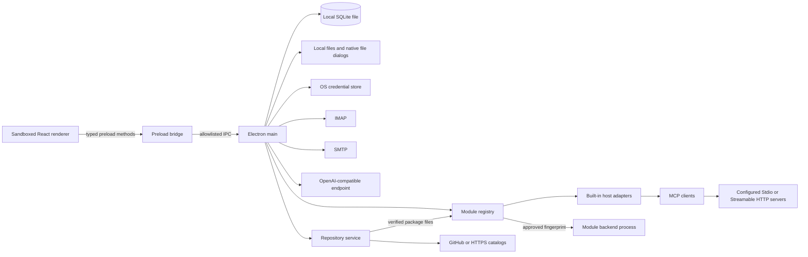

# Architecture

For the prioritized implementation backlog and acceptance gates, see the [maturation plan](maturation-plan.md). This document describes the architecture and current implementation.

[Documentation](README.md) · [Contributing](../CONTRIBUTING.md#building-modules) · [Desktop app decision](decisions/0001-local-desktop.md)

## Processes and trust boundaries

Mail, chat, chat management, drafts, files and settings run in separate Electron windows. The dock is another window. The main process owns shared state and exposes named methods through the preload; IPC handlers verify the sender. Renderers use `contextIsolation` and a sandbox, with Node integration disabled. Navigation, new windows and browser permissions are restricted. See [`electron/main.ts`](../electron/main.ts) and [`electron/preload.ts`](../electron/preload.ts).

### Markdown in chat

User and assistant messages use `react-markdown` for CommonMark and `remark-gfm` for tables, task lists, strikethrough, automatic links and footnotes. Stored Markdown source remains unchanged for model context, copying, editing and chat forks. Code blocks have a copy action; wide tables and code scroll inside their message. Raw HTML is not executed. The renderer is [`src/ChatMarkdown.tsx`](../src/ChatMarkdown.tsx).

Links retain their actual destination and work with the mouse or keyboard. The typed `openExternalLink` preload method passes destinations to a handler restricted to the chat window. [`shared/chat-links.ts`](../shared/chat-links.ts) validates HTTP, HTTPS and `mailto` links in the renderer and again in the main process, rejecting embedded web credentials and control characters. `shell.openExternal` opens the default application; it does not navigate the OVD window. Fragment and footnote links stay inside the same message. Remote Markdown images initially show alt text and the destination host. They load without a referrer only after the user selects **Load image** (currently **Bild laden**).

## The workspace assistant as a product principle

The OVD assistant is an equal entry point to every implemented workspace function. It should support the same work as the mail, draft, file, window, chat and settings interfaces: retrieving information, navigating, preparing changes and executing permitted actions. Each new UI function must include its assistant access. Missing tools are integration gaps to close, rather than a permanent product boundary.

The UI and assistant share domain services through named, typed and validated capabilities in the main process. Each capability describes its arguments, resource IDs, prerequisites, permissions, required confirmations and possible outcomes. The assistant receives bounded tools; it does not need arbitrary code execution or a general IPC bridge. Claims about capabilities and completed work must match the offered catalog and actual results.

The implementation is split across these components:

- [`electron/modules.ts`](../electron/modules.ts) discovers and validates manifests, associates functions with modules and exposes available modules to discovery. [`shared/modules.ts`](../shared/modules.ts) defines metadata, contributions and discovery contracts.
- [`modules/ovd-assistant/module.json`](../modules/ovd-assistant/module.json) declares the mandatory chat, workspace, window and settings module. [`modules/ovd-mail/`](../modules/ovd-mail/) contains the optional mail backend, UI and manifest for mail, drafts, account settings and references.
- [`modules/ovd-files/`](../modules/ovd-files/) owns the optional file manager, file service, capabilities and UI. Files are no longer a core navigation contribution of the assistant; saved ordering positions using the old `files` ID migrate to `ovd-files:files`.
- [`modules/ovd-mcp/`](../modules/ovd-mcp/README.md) owns optional MCP settings, configuration, secret storage and transports. Connected servers with permitted tools appear as short virtual sources through [`ModuleToolProvider`](../shared/module-tool-provider.ts); their schemas are loaded only on demand.
- [`electron/workspace-capabilities.ts`](../electron/workspace-capabilities.ts) defines core operations and the common registry. Optional modules own their Zod schemas and descriptions, such as [`modules/ovd-mail/backend/capabilities.ts`](../modules/ovd-mail/backend/capabilities.ts), and register definitions with handlers through `registerDefinition` when activated. Host adapters connect both entry points to the same services. The operation context carries cancellation, the originating chat and explicitly selected resource IDs; the registry validates inputs and bounds results.
- [`electron/agent-tools.ts`](../electron/agent-tools.ts) initially offers only `find_modules` and `get_module_tools`. [`electron/agent.ts`](../electron/agent.ts) keeps selected functions for the current task and accepts only tool names actually offered for the current model response.
- [`electron/module-runtime.ts`](../electron/module-runtime.ts) starts approved third-party modules through [`electron/module-worker.ts`](../electron/module-worker.ts) in separate processes. The host validates declared functions, ownership and confirmations, giving the UI and assistant the same execution path.

### Module startup and context budgets

#### Contributions and navigation

Navigation uses stable IDs: `assistant`, `sessions` and `settings` for core entries, and `moduleId:entryId` for module contributions. The former core ID `files` is accepted for migration only. `Settings.navigationOrder` stores an optional custom order; [`shared/navigation.ts`](../shared/navigation.ts) defines core entries and orders contributions. Settings and the dock use the same frontend catalog. Disabled or unavailable entries retain their saved position but disappear from the dock. New entries follow saved entries. An empty order restores contribution defaults. Ordering does not change module activation, fingerprint approval or settings categories.

`navigation.get` returns the available catalog in pages; `navigation.move` moves one entry relative to another. `settings.update` also accepts a full order or an empty reset. All paths share validated persistence. Unknown or duplicate IDs and lists missing active entries are rejected. General settings writes are serialized and published only after successful persistence; a write failure leaves the previous saved state visible.

At startup, OVD reads built-in modules from `<appPath>/modules/` and user modules from `<userData>/modules/`. Each has a `module.json`. Unsupported API versions, invalid manifests and conflicting registrations produce a visible status with a reason. Discovery alone never runs third-party code. Under **Settings → Modules** (**Einstellungen → Module**), the user can approve a module's file fingerprint or disable an optional module. Approval is stored in `module-settings.json` and applies only to that exact file state; changed files require fresh approval. Disabled modules expose no tools, navigation or settings contributions, while their data remains. `ovd-assistant` is always active.

Bundled modules use trusted host adapters registered by OVD. Downloaded modules use the process runtime and cannot replace built-in `ovd-` IDs or register internal host adapters. A repository supplies packages for that runtime; it is not a second implementation of module activation. MCP servers are different again: the built-in MCP adapter exposes their permitted tools as virtual sources without installing them as OVD modules.

#### Repository lifecycle

The [repository service](../electron/module-repositories.ts) manages multiple public/private GitHub and direct HTTPS catalog sources through **Settings → Modules**. Saving a source stores configuration; refreshing fetches metadata; installing downloads a selected package; approving its fingerprint permits execution. These are distinct operations. Source settings and installation receipts persist in `module-repositories.json`, while credentials live in the OS credential store and loaded catalogs stay in session memory. Catalog metadata is untrusted data and never becomes an instruction or an automatically offered domain tool.

GitHub sources resolve the catalog and package files against one repository tree. Direct HTTPS sources use the catalog's per-file SHA-256 values. Installation stages files, verifies hashes and manifest identity/compatibility, and asks the module host to replace only the expected unchanged installation from that source. It performs no build, dependency installation or lifecycle script. The host stops the affected idle module, closes its views, swaps the package with recovery metadata, persists provenance, removes its old execution approval and publishes the new registry record. Disabled modules remain disabled; other modules keep running. `module-data/<moduleId>/` remains separate from the package and survives its replacement. Source removal does not uninstall modules or delete their data.

Downloaded packages appear immediately without an app restart and require separate approval before their code can run. Process startup itself is lazy, on a backend invocation; there is no general external-module startup service. Manually copied or edited folders are discovered on the next app start. Update selection is explicit, with no scheduled updater or source takeover of local/foreign packages. The current catalog has no dependency resolver, minimum-app-version negotiation or OS/architecture package selection. See [module repositories](module-repositories.md) for setup, private credentials, publishing, recovery and limits, and [module authoring](../CONTRIBUTING.md#building-modules) for the runtime contract.

The Assistant reaches this same lifecycle through `modules.repositories_list`, `modules.repository_prepare`, `modules.repositories_refresh`, `modules.repository_catalog`, `modules.repository_install`, `modules.repository_remove` and `modules.set_enabled`. It can prepare source metadata in Settings, inspect catalogs and request installation/update of an exact source/module/version. The user saves source configuration and supplies credentials; new code approval remains explicit even with **Without confirmations**. The repository catalog and the installed tool catalog remain separate: an available package does not become usable until it is installed, enabled and approved.

#### Lazy tool discovery

Initial model context contains at most 20 short module descriptions within 6,000 characters and the two discovery tools. For “search for Hetzner”, `find_modules` locates the mail domain, `get_module_tools` loads the search function, and only that domain tool receives “Hetzner” as the content query. Discovery searches module and function descriptions, never mail contents. Both catalogs are bounded and paginated.

Module and tool matches are ranked by matching terms; extra words or numbers do not eliminate an otherwise matching result. Lower-ranked matches remain reachable on subsequent pages, and `hasMore` describes the whole matching set. If a narrow query misses the desired function, the assistant can broaden it or page through an unfiltered catalog without preloading every schema.

Loaded input schemas appear only in the tool definitions of subsequent provider requests. Discovery results contain short metadata, not schemas. **Settings → Agent** controls execution and context budgets. Defaults allow 12 active domain tools and 40,000 characters for the entire tool offer, including the two discovery tools; loading further tools evicts older selections. A run permits 25 tool rounds, 80 calls and 300 seconds. The separate provider timeout is 60 seconds; streaming measures time without incoming data. Settings changes apply to new tasks. One transport retry is allowed by default, only for malformed responses whose tools have not executed. Tool catalogs and raw execution messages remain in the run's memory. New answers separately retain bounded result evidence for deliberate [answer reformulation](#answer-reformulation); neither schemas nor recorded evidence are automatically added to ordinary history context. Adding a module therefore does not expand the initial tool schema catalog.

### Shared foundations: time, calculations and queries

Every provider request receives a small current host context: UTC time, local date/time with offset, IANA time zone and locale. This also applies with workspace tools disabled; time is not inferred from old messages or mail. `context.get` adds the current access and confirmation mode, originating and active chat IDs, bounded reference metadata and active selections. The lazily loaded `time.now`, `time.resolve_range` and `time.difference` functions refresh time or resolve calendar boundaries and differences. [`shared/time.ts`](../shared/time.ts) uses Temporal with an explicit time zone, so daylight-saving days may have 23 or 25 hours. Weeks start on Monday; `last_7_days` and `last_30_days` include today. Ranges include their start and exclude their end.

`math.calculate` handles bounded sums, averages, products, differences, division, percentages, minima and maxima. Decimal values use BigInt fractions; results explicitly report rounding and precision. There is no `eval` or general SQL/code interface. These schemas follow the same on-demand discovery path as other module functions. See [`shared/calculation.ts`](../shared/calculation.ts).

The mail module shares the AND-combined filters in [`shared/mail-query.ts`](../shared/mail-query.ts) between `mail.query` and `mail.count`: text, sender, recipient, subject, read status and received-time range. The default scope is the active or first account's inbox; additional or all accounts and folders are explicit options. The UI exposes the same services under **Filter & count** (**Filter & Anzahl**) with **Show mail** (**Mails anzeigen**) and **Count only** (**Nur Anzahl**). Counts refer to the server scope, not the currently loaded list. Existing local view filters are identified as filtering loaded messages.

Count requests return no mail bodies or individual messages to the model. For server-only filters, the service uses ESEARCH COUNT or SEARCH as a fallback. Received-time filters use a broad IMAP day prefilter, then compare actual INTERNALDATE values against precise UTC boundaries; sender date and receipt time remain separate. Date sorting considers all matching candidates within the stated metadata budget. A query examines at most 10,000 candidate metadata records per folder and 50 folders. Limits reached, missing dates, inaccessible folders and observation times are reported. `countExact` describes the reliability of the count; `complete` describes collection or sorting completeness. A lower bound must not be presented as a total. Copies in different folders count as separate folder entries and are identified accordingly.

Query lists contain at most 20 metadata records per page, with a default of 10. The host merges sorting across folders and uses short-lived cursors tied to filters and scope. It advances each folder only for entries actually emitted. Account, UIDVALIDITY, candidate-set or filter changes require restarting the query. Cursors expire after 10 minutes, with at most 100 retained cursor states. With Workspace tools enabled, the assistant can query configured accounts and read or open known message IDs needed for the task without separate mailbox or per-message consent. Resource identity, account configuration, cancellation and completeness checks still apply. See [`mail-query-service.ts`](../modules/ovd-mail/backend/mail-query-service.ts) and [`mail-query-host.ts`](../modules/ovd-mail/backend/mail-query-host.ts).

### Agent settings and limits

`WorkspaceState.agentSettings` is independent of the AI provider configuration. It can be saved before a provider is configured and changes neither provider/model selection nor access or confirmation mode. [`shared/agent-settings.ts`](../shared/agent-settings.ts) centralizes defaults, bounds and validation. `settings.agent_get` reads saved values; `settings.agent_save` prepares changes in the form. Only the user's save action commits them. A running task cannot raise its own limits.

| Setting | Default | Range |
| --- | --- | --- |
| Tool rounds | 25 | 1–100 |
| Tool calls, including discovery | 80 | 1–500 |
| Total agent runtime | 300 seconds | 15–1,800 |
| Provider/request wait | 60 seconds | 5–600 |
| Simultaneously active domain tools | 12 | 1–24 |
| Serialized tool offer, including schemas | 40,000 characters | 8,000–80,000 |
| Earlier messages in context | 30 | 0–100 |
| Earlier-message text budget, including references | 60,000 characters | 0–200,000 |
| Extra attempts for malformed tool-response transport | 1 | 0–2 |

Older messages are omitted as whole messages from the beginning of the retained history. The current request and the bounded snapshots of its explicitly selected references remain included. Zero for either history budget excludes older history. The provider context briefly identifies omitted history. Character budgets are not token counts. Domain tools and their results remain task-scoped and bounded.

A task that reaches a limit finishes with status `limited` and `agentRunLimit`: reason, consumed rounds/calls, discovery and domain-call counts, duration and the kind of pending step. Completed actions and recorded outcomes remain intact; raw tool responses stay in the run's memory. A requested batch starts only calls still within budget. Updating settings does not automatically resume a stopped task. If an action's outcome is unknown at timeout, it is marked uncertain for the user to check and is not retried automatically. The chat offers a direct link to agent settings.

Streamed and complete provider replies accept multi-call batches, including individual reads of each query result. The transport retains byte and per-argument size bounds; the configured agent budget controls how many calls execute. A malformed or oversized tool-call batch is rejected before any of its calls execute. Diagnostics identify the field and, for size failures, the call index, observed character count and limit without exposing field values. Both cases use the configured complete-response fallback with the same conversation and tool offer; it requests only the unexecuted turn again and does not restart earlier completed actions. Oversized complete responses remain rejected; the fallback does not raise limits, trim arguments or execute a partial batch.

Missing argument text is normalized to `{}` only for an explicitly parameterless object schema. A tool with optional fields, such as `mail.read` with an optional `emailId`, still requires JSON argument text. An explicit `{}` can select its documented defaults; missing stream arguments cannot silently turn a targeted call into a default-target action.

### Confirmations and actual tool outcomes

`AiConfig.confirmationMode` defaults to `ask`. With Workspace tools enabled, requested domain reads and view navigation work autonomously in either mode: Mail discovery, folder listing, queries, counts, previews and message reads need no additional mailbox switch or individual consent. The shared confirmation flow still applies to sending, destructive actions and protected configuration. The explicitly saved `never` option, **Without confirmations** (**Ohne Abfragen**), skips those individual dialogs for requested assistant actions with `origin: agent`. Direct UI actions retain their normal confirmation behavior. The host's `confirmCapability` makes this decision centrally. The setting changes no OS permissions, reveals no secrets and starts no work by itself. New or changed third-party module code still requires its own fingerprint approval, and MCP tool permissions remain separate. The assistant can only prepare the mode in the form; the user must save it.

Domain actions can return `outcome: completed | failed | cancelled | uncertain` with a short message. The host interprets this consistently for tool output and saved activity. An empty `error` field is not a failure. An explicit non-success ends the current action run with the host's message, preventing additional calls and a contradictory model success claim. Speculative text from a tool turn is rolled back before execution; answer-only turns continue streaming. SMTP `sent` means confirmed server acceptance only. Uncertain or already accepted messages block automatic repeats; partial recipient rejection and local persistence problems after acceptance are separate warnings.

### Answer reformulation

**Reformulate answer** (**Antwort neu formulieren**) creates a separate chat branch using the recorded request, reference snapshots, previous answer and bounded result evidence. The host uses a dedicated text-only provider path with no tool execution dependencies. It does not call the normal agent loop, discover modules, reread current sources or repeat an action. This remains true with **Without confirmations** (**Ohne Abfragen**) enabled; confirmation mode cannot enable tools on this path. Unexpected provider tool calls fail rather than entering an execution fallback.

The UI and the lazily discovered `chats.reformulate` capability share this operation. An accepted assistant request ends its current agent run immediately: later calls in the same response are skipped and there is no further ordinary provider turn. After successful completion, the host starts the separate text-only operation; it does not start another agent recursively. Stop, failure, a non-completed tool outcome or an execution limit discards the pending handoff with a visible notice. A reformulated answer is visibly marked **Reformulated · no actions** (currently **Neu formuliert · keine Aktionen**). The original session and unsent composer selections remain available. Editing a request into a new chat is a separate flow: submitting that editable request starts a new task with the applicable permissions.

[`shared/chat-evidence.ts`](../shared/chat-evidence.ts) bounds each serialized evidence record to 24,000 characters and each result snapshot to 8,000. Evidence contains recorded domain-tool outcomes and redacted result excerpts, with truncation and omitted-outcome information when needed. Discovery catalogs, schemas and tool arguments are excluded. The evidence is untrusted historical data, not permission or proof of a current resource state. New tool-free answers also receive an evidence record. Older answers without usable evidence show an explanation before a branch or provider request is created; OVD never rebuilds missing results by replaying their original task. Limited evidence must not be described as complete, and recorded failed, cancelled or uncertain outcomes must retain that meaning.

Evidence is saved with its answer in the existing workspace store. It supports reformulation after restart and remains separate from the durable action journal described below. Reformulation does not consult that journal to resume work or enable tools.

### Durable operations and explicit continuation

Agent domain calls use host-generated run, logical action and attempt IDs through [`OperationJournal`](../electron/operation-journal.ts) and [`OperationRunner`](../electron/operation-runner.ts). Continuations share a root-run identity; a new explicitly sent request creates a separate task even when its text matches an earlier request. The host persists a validated intent before dispatch, acknowledges the dispatch boundary before the domain call can start, and records the actual terminal outcome afterwards. Records bind the module/code/schema offer, canonical arguments and any module-supplied resource ID/version. A never-dispatched first step in the original run may finalize its current resource revision while preserving resource identity; this does not establish that the revision changed only because of earlier steps in that run. Final validation after durable acknowledgement and after relevant confirmations rejects subsequent changes. Resumed/retried steps always require their old bound version and never refresh it.

The journal is stored independently of workspace snapshots at `<userData>/operation-journal/operations.json`. It is **unencrypted** and retains ordinary frozen arguments, timestamps, current attempt identity/count, outcome/effect certainty and redacted bounded results. Sensitive argument keys are rejected; structured secret result keys are removed, and modules must never embed credentials in free text. The OS credential store remains separate. Each argument object is limited to 16,000 UTF-8 bytes, each saved result to 8,000 characters, each action record to 24,000 UTF-8 bytes and the file to 32 MiB. Results may be reduced or omitted while outcome guards remain. The writer serializes atomic file replacements and acknowledgements. Corrupt, oversized/full or unwritable journals stop new agent actions and preserve existing evidence instead of silently resetting it. Do not delete the journal as a retry workaround.

After a restart, a previously running action becomes uncertain; trusted effect-free reads retain effect `none`, while other effects remain unknown. Runs never resume automatically. **Continue task** (**Auftrag fortsetzen**) is a separate explicit entry point from **Reformulate answer** and editable new requests. It opens a continuation branch carrying the original request/snapshots and bounded historical action metadata. Matching completed calls reuse historical outcomes without executing again, even if their complete result is no longer available. Known safe pending/failed original steps can run only with current permissions, unchanged approved code/schema and frozen resource version. Explicitly audited effect-free reads may be requested as needed. An unplanned write is rejected and requires a new explicitly submitted user request; alternate tool names or arguments cannot expand the saved task.

An action with a possible external effect stays blocked until its module can reconcile it. **Task status** (**Auftragsstatus**) loads a compact journal summary on expansion; **Check status** (**Status prüfen**) calls a separate reconciliation hook, never the original action. Unsupported or still-unknown outcomes remain blocked. The Assistant discovers the same `chats.continue`, paged `operations.get_run`, bounded `operations.read_result`, `operations.retry` and `operations.reconcile` capabilities lazily. Summaries expose no original arguments or result blobs; result retrieval is explicit, historical and bounded. Neither the whole journal nor module catalogs enter every request.

Within an explicit continuation, `operations.retry({actionId})` asks the host to execute exactly one eligible saved step with its original validated arguments. The model need not reconstruct arguments or receive a bulk argument dump. Outside that continuation it is rejected. A permitted retry preserves the logical action ID, creates a new attempt identity and passes the same journal, current-permission, approval and strict resource-version guards as a directly selected saved step; completed steps still only reuse historical results. Stable module/action lookup finds the current offered tool, including an MCP tool whose connection-specific name changed, without dropping configuration/schema/approval checks.

Approved process modules can supply optional `prepareOperation` and `reconcile` hooks, with host operation IDs in the tool context; see [module recovery hooks](../CONTRIBUTING.md#durable-action-hooks). Without adequate binding/status support, uncertain writes remain unavailable for automatic retry. MCP bindings use stable server/tool/configuration/schema identity independently of connection-specific offered names. Remote read-only annotations are not accepted as proof of an effect-free call, and MCP currently has no general reconciliation of remote effects after a lost response.

The Mail adapter freezes omitted draft/mail/source/account selections and hashes business-content/configuration revisions. Send retry binding excludes status/error/timestamp changes caused by the attempt itself; filing binds its immutable outgoing Message-ID and fixed folder rather than mutable filing outcomes. Its status hook checks existing SMTP and Sent-copy guards without SMTP or APPEND: confirmed acceptance/filing is reused, definite acknowledged non-acceptance or an unattempted filing can establish no effect, and ambiguous outcomes remain unknown. An explicit Sent-filing operation retains its existing Message-ID reconciliation rules and never resends. Audited `mail.search` and `mail.query` are trusted business reads: they can present results in the Mail window but do not modify mailbox content, mark mail read or send messages, so a failed search can be continued under current access checks. This classification does not turn R01a into a tool-enabled path. Other Mail mutations without an authoritative reconciliation path remain blocked when uncertain.

This is not a transaction spanning OVD and a remote service, an exactly-once guarantee or complete workspace durability. Broader save feedback/recovery remains R05; backup/restore and retention remain later packages. The journal protects its own records independently of ordinary workspace autosave.

### Third-party module contract

The host also owns bounded session-local module attention. Approved process modules receive identity-bound `attention.publish({ key, message })` and `attention.clear(key)` in their activation context. Built-in adapters use the same store through host callbacks. The primary Dock entry and module Settings categories display a ten-second breathing dot followed by a static dot; reduced motion disables animation. Visits acknowledge captured notice IDs, so newer revisions survive an opening/acknowledgement race. Disabling/failing a module clears its hints and rejects late process publication. No hint is an action, access grant or automatic prompt addition. Lazy `modules.attention`/`modules.acknowledge_attention` expose the same state. See the [authoring contract](../CONTRIBUTING.md#module-attention-indicators).

A process module supplies a prebuilt CommonJS entry exporting `activate({ moduleId, dataDirectory, attention })`. Its result contains exactly the manifest-declared handlers in `tools` and optionally `dispose()`, `prepareOperation()` and `reconcile()`. A handler receives `(args, { signal, operation? })`; host operation identity is present for journalled agent actions and is not an access grant. Every implemented UI domain workflow must be reachable through the same functions from the Assistant. The host creates provider-compatible tool names and keeps the mapping to module and manifest function. It also generates view/window/settings navigation tools from contributions; authors implement their own domain behavior and settings persistence.

Custom HTML views and settings run in isolated iframes with a bounded message bridge restricted to their own module's functions and reference selection. The current CSP requires self-contained HTML with inline scripts/styles; it blocks direct network requests, external scripts/styles, frames and form navigation. Backend services own remote calls and storage. The activation API does not expose OVD's workspace state or a generic credential-store service, and saved host credentials are not forwarded to process modules. Dynamic `ModuleToolProvider` registration is limited to built-in host adapters; installed process modules use their manifest-declared tools. See the [HTML bridge](../CONTRIBUTING.md#html-views) and [discovery contract](../CONTRIBUTING.md#discovery-and-context-budgets).

The backend process isolates failures but is **not an OS sandbox**: approved code runs with normal user permissions. Declared permissions describe intended access; they do not enforce OS restrictions. Only trusted local code should be approved. The runtime bounds startup, call duration, concurrency and JSON sizes and does not automatically replay failed calls. Current process-module bounds are a 10-second startup, 60-second invocation, 16 pending calls, 16 KiB of argument JSON and 32 KiB of result JSON. These transport bounds are separate from the agent's task budget. Module-owned data lives under `<userData>/module-data/<moduleId>/`. See the [developer contract](../CONTRIBUTING.md#building-modules) and [notes example](../examples/notes-module/README.md).

| Function group | Available workflows |
| --- | --- |
| Context and windows | Identify active mail, references and drafts; list, open, focus, minimize, maximize and close workspace windows |
| Drafts | List, read, create new or reply drafts, open and edit fields; request sending through the configured confirmation flow |
| Mail | List accounts/folders, page messages, search/query/count on the server, navigate and filter results, read/open known mail IDs, change read status and save attachments |
| Files | Browse accessible local folders, choose files, read supported text, add chat references and attach/remove draft attachments |
| Chats and operations | List/read saved history in pages, create, open, rename, reference and fork chats; reformulate without tools; explicitly continue eligible recorded tasks and inspect/reconcile their bounded operation records; choose a model for following messages |
| Settings and accounts | Change display settings, open categories, read public AI/SMTP configuration and test connections; prepare protected forms or request credential/account removal |
| MCP | Manage saved connections, prepare settings and permissions, inspect tool metadata/audit and invoke explicitly permitted server tools through lazy discovery |
| Modules and repositories | Inspect installed modules and attention hints; prepare source settings, fetch/search catalogs, request package installation/updates and activate/disable optional modules |
| App | Request quitting through the configured confirmation flow |

`settings.ai_save`, `accounts.save` and `smtp.save` prepare protected forms using public fields. The user supplies secrets only in the UI and explicitly saves. `accounts.save` prepares a new IMAP account or edits an existing one with `accountId`. IMAP and SMTP share one account group; updates preserve its ID and draft/SMTP associations. Empty password fields retain saved credentials when connection identity is unchanged. Changing IMAP server or login requires new credentials. SMTP configured to share IMAP credentials uses the account's current IMAP username and saved password.

For example, a user references a mail and requests a new message to its sender. The main process resolves the reference, obtains the sender address from known mail data, calls the same draft service as the UI, then opens the correctly addressed draft. The assistant checks and reports the result. A reply uses the reply operation with Reply-To and conversation headers instead.

The assistant can search and read configured mailboxes for the user's task whenever Workspace tools are enabled, independently of reference selection and the confirmation mode. There is no separate general-mail switch or per-message grant list. Bodies load only when needed, and bounded results describe the actual queried scope. The example mailbox is no longer exposed in the UI; retained internal sample data is excluded from real-mail tools. Opening a real mail does not mark it read. Tool selection and execution happen in the main process, and the model receives only offered tools and their results. Mail can contain malicious instructions; labeling it untrusted alone is not a guarantee against prompt injection.

### References and full-content retrieval

Dragging mail into chat selects context for a message. The payload contains only a resource ID. The main process validates it against known messages and returns reference metadata. On send, it resolves the content and saves a bounded snapshot with the message. The renderer cannot promote arbitrary supplied text into a trusted mail reference. References identify relevant context rather than granting read permission; the assistant can discover other needed messages through the Mail tools.

The common chat UI calls the action a **reference** and uses a reference icon. Type-specific chips and remove actions name the actual resource type. Supported mail, chat and generic module drag formats trigger the reference drop hint; ordinary text does not. Legacy ID prefixes remain a fallback on drop. The active chat cannot reference itself and is not draggable in the chat manager.

Chat references retain their stable chat ID in model context. New snapshots report capture time, source modification time, message count and truncation; completeness of an old saved preview remains explicitly unknown. A preview considers at most the latest 40 eligible messages, at most 8,000 characters from each, and is bounded to 20,000 characters overall. Nested references are not expanded. When a task needs more or current content, the assistant discovers `chats.read` in the mandatory module and reads stored messages by chat ID in pages. Long messages are split into resumable parts. A cursor is tied to the exported content revision; actual content changes require a fresh read, while tool-activity-only updates do not invalidate it. Reading does not select or open a chat window; `chats.open` remains a separate navigation action. See [`shared/sessions.ts`](../shared/sessions.ts), [`shared/chat-history.ts`](../shared/chat-history.ts) and [`electron/chat-history.ts`](../electron/chat-history.ts).

### Optional files module

`ovd-files` provides `files.list`, `files.open`, `files.choose`, `files.read` and `files.reference`. The file manager and assistant share the same service. Lists filter names in the current folder and sort by name, size or modification time; pages stay within the shared result budget. `files.open` navigates the file manager and selects a file without executing programs. The UI provides text previews, metadata, chat references and attaching files to an active mail draft.

Documents is the starting location, not an access boundary. The file manager and assistant can use any local file or folder accessible under the user's OS permissions, without a separate OVD path grant or mandatory picker step. The editable path bar, breadcrumbs and parent action reach the filesystem root; `~` resolves to the home directory. The service resolves canonical paths and rechecks file identity on access. Persisted path metadata can restore referenced file IDs after a restart; an unknown ID requires listing the folder or selecting the file again. The shared native mail-attachment picker remains available without the file-manager module.

Supported UTF-8 text formats, including TXT, Markdown, source code, JSON and CSV, can be read fully in pages up to a 2 MiB file limit. Version-bound cursors prevent continuing against a changed file. PDF, Office documents, images, binary files and larger text files currently return metadata with an explicit reason; they are not represented as read content. A file-reference snapshot contains at most 4,000 text characters and reports readability, truncation and source version/time. Additional content is fetched only when needed through `files.read`. See [`shared/files.ts`](../shared/files.ts) and [`file-service.ts`](../modules/ovd-files/backend/file-service.ts).

[`shared/references.ts`](../shared/references.ts) defines generic module references. Drag data contains only the module ID, type and resource ID. [`electron/module-references.ts`](../electron/module-references.ts) dispatches to registered, available module resolvers, validates identity and bounded outputs, and lets the owning backend create snapshots. Process modules can declare an own `snapshotTool` on a reference type; the host resolves `{id}` through the approved process and normal schema checks rather than registering stale adapters across package changes. The isolated HTML bridge also accepts `ovd:reference` as an accessible selection alternative and verifies module ownership in the main process. Chat has no file-specific content resolver. References survive unsent drafts, send recovery, saved history and forks. Disabling a module removes its view, navigation and tools; existing saved snapshots remain readable. New source-content access requires the module to be active.

An approved reference contribution can declare `usage: instructions`. The host assigns that role from the manifest, never from drag data or a backend's claimed role. When the user explicitly selects such a reference, its complete, readable snapshot supplies working instructions only to that submitted request; other selected mail and file references remain source data. This grants no additional access or exemption from action approval. Unavailable or incomplete instruction references fail visibly instead of using saved snapshots as new instructions. History and forks preserve their recorded content without automatically activating it for a later request. See the [module reference contract](../CONTRIBUTING.md#resource-references) for authoring and host compatibility.

Reference titles and descriptions come from the owning module. Chat uses a generic **Instruction** role marker (currently **Anweisung**). Shared presentation and host errors do not require optional-module feature names. Users configure their own AI provider; chat, settings and permission dialogs omit routine provider-transfer notices.

Structured `UiAction` objects cover window, draft, file and mail actions, but represent only part of the implementation, not a complete capability boundary. UI behavior must be checked against the offered capabilities and gaps closed. Inputs and resource IDs are validated at the shared service entry point, which returns an observable result.

Sending, destructive actions and protected settings use the common, understandable confirmation/preparation flow, subject to the user's saved confirmation mode. The assistant can start it, but cannot silently grant itself configuration or access. Secrets stay in the intended settings flow and are not returned as model context. Missing permission, required input, cancellation and successful execution must remain distinguishable.

## State model

[`WorkspaceState`](../shared/model.ts) includes window positions, retained sample mail, drafts, settings and chat sessions. [`electron/store.ts`](../electron/store.ts) stores it as a JSON value in a local SQLite table. Unsent chat text and pending mail/module reference metadata are also kept in renderer-local storage for recovery; pending chat-reference selection is retained per session in the open chat window. The SQLite file is not encrypted. Although fetched IMAP messages are cached only in memory, local drafts, explicitly sent reference snapshots, chat responses and bounded answer evidence can contain real mail or file content. Snapshots preserve bounded text and metadata for history and forks after a restart. Downloaded attachments are written to the user's selected location.

Workspace writes capture their serialized snapshot when requested, then run in order. The store writes the exported SQLite bytes to a temporary file, flushes that file, atomically replaces `workspace.sqlite`, and flushes the directory entry on non-Windows platforms before acknowledging success. This strengthens the existing storage path without introducing a new database schema.

Before a persistent mail cache is introduced, the plan calls for a relational schema for accounts, folders, messages, MIME parts, threads, drafts, attachments and sync cursors, with versioned, transactional migrations. Large attachments belong in managed files, with metadata and references in SQLite. The current `sql.js` implementation loads/exports the complete database and atomically writes its file; it is not yet the planned large-mailbox store.

### Draft persistence and recovery

The Mail module's [DraftPersistence](../modules/ovd-mail/backend/draft-persistence.ts) compares complete draft revisions, queues pending changes, and acknowledges only the revision actually written. Its [shared status contract](../shared/drafts.ts) contains `draftId`, `contentUpdatedAt`, `status: saving | saved | error`, an optional actual `savedAt`, and any error. These transient status records are not persisted as draft content. Drafts loaded successfully from disk start as saved without a fabricated last-save time.

The [draft frontend](../modules/ovd-mail/frontend/index.tsx) subscribes to status changes, rejects stale query responses, and accounts for pending renderer edits before displaying saved. It offers explicit save/retry and Cmd/Ctrl+S. The shared mutation path awaits persistence for edits and attachment changes; failures retain the in-memory draft. Native close and app quit flush pending drafts and keep the relevant window/application open if saving fails. Only successfully acknowledged revisions are guaranteed by this flow; unacknowledged edits can still be lost after an abrupt process failure.

The assistant discovers `drafts.save` and `drafts.save_status` through the ordinary module catalog. `drafts.get` and `drafts.list` include `saveState`, and `drafts.update` waits for the same persistence path before reporting success. Startup restores stored account, recipient, body, reply-header and attachment-reference fields. Attachments remain external local files rather than managed copies. These acknowledgements concern local draft storage, separately from SMTP acceptance and Sent-copy filing.

## Mail pipeline

1. **Implemented:** create IMAP accounts, test connections and keep credentials in the OS store. A local account file contains metadata without passwords. The UI loads up to 25 messages per page by default, using UID and UIDVALIDITY for identity, and shows at most 500 messages at once. Bodies load on demand; attachments download individually through a save dialog. Read/unread changes are explicit, and opening a message does not change that status. Direct TLS or required STARTTLS with certificate validation protects the connection.
2. **Implemented:** text drafts and attachment references are saved locally. SMTP is configured separately per account. Manual sending uses a visible confirmation; assistant sending uses that same host flow and the saved `ask`/`never` mode. The app reports an uncertain outcome when server acceptance is unknown and prevents directly resending that draft. SMTP acceptance is neither delivery confirmation nor a guaranteed copy in Sent. The model cannot enable confirmation bypass itself.

   [SMTP preparation](../modules/ovd-mail/backend/smtp-service.ts) creates stable MIME bytes, a `Message-ID`, date and explicit SMTP envelope before transmission. The [outgoing store](../modules/ovd-mail/backend/outgoing-store.ts) persists this immutable preparation for later Sent-copy retries, including attachment contents; those retries do not depend on original attachment paths. The transmitted MIME omits BCC headers. Raw bytes and local spool paths stay within the Mail backend. These locally retained message copies are unencrypted and are removed after confirmed filing state has been persisted; unresolved filing retains them for recovery.

   After confirmed SMTP acceptance, [Sent filing](../modules/ovd-mail/backend/sent-service.ts) uses a unique selectable `\Sent` folder or an unambiguous common-name fallback. The interface and `drafts.file_sent` can explicitly select an existing folder when automatic resolution is insufficient. An exact `Message-ID` match is reused before any APPEND. A durable attempt marker records the target before APPEND; an uncertain attempt permits only reconciliation on later retries, including after restart. A definite rejection can be retried as a filing operation. SMTP is never invoked by that retry. The separate persisted `sentCopy` state is visible in the editor, `drafts.get`/`drafts.list` and `drafts.sent_status`. The filing state cannot turn known SMTP acceptance into a new sendable draft. Legacy accepted drafts without prepared bytes are reported honestly as unavailable for this flow. IMAP provides no atomic append-if-absent operation; a delayed provider-created copy can race with the initial search and APPEND. This bounded reconciliation cannot promise exactly one Sent copy across every provider and is not full mailbox synchronization.
3. **Planned:** full IMAP synchronization with persistent cache, delta sync and reconnection, plus protection for mail data at rest. There is no persistent local full-text index; server search remains bounded per task.
4. **Implemented:** bounded HTML/text alternatives and a modular HTML reader. [`mail-service.ts`](../modules/ovd-mail/backend/mail-service.ts) loads plain text and HTML separately, validates UID/UIDVALIDITY in a read-only mailbox, and keeps ordinary attachment downloads separate. HTML is limited to 128 KiB and plain text to 20,000 characters; HTML-only messages get a converted text fallback, and the two views report truncation independently. Referenced CID raster images have signature checks, at most ten reads, a 512 KiB per-image bound and a 2 MiB retained-byte budget. Unsupported or unavailable embedded images remain placeholders.

   [`mail-html.ts`](../modules/ovd-mail/frontend/mail-html.ts) uses [DOMPurify](https://github.com/cure53/DOMPurify), pinned in [`package.json`](../package.json), and a restricted inline-CSS allowlist. Scripts, event handlers, forms, nested frames, plugins, SVG/MathML, sender style blocks and external stylesheets are removed. [`HtmlMailBody`](../modules/ovd-mail/frontend/HtmlMailBody.tsx) renders only that result in a `srcdoc` iframe with `sandbox="allow-same-origin"`, without script/form/popup/top-navigation permissions, and with a restrictive child CSP. The parent uses same-origin access for sizing and controlled link activation; it never grants sender scripts an execution path. Unintended frame navigation is blocked. Valid HTTP(S)/`mailto` link clicks go through the Mail backend's main-process validation and `shell.openExternal`.

   The session-local [`MailDisplayState`](../shared/mail-display.ts) defaults to `format: auto` and `remoteImages: false` per message. The UI and lazily discovered `mail.set_display`/`mail.display_status` share the same backend path. The assistant can choose HTML/text, open the relevant Mail view and inspect the effective fallback. Enabling external images through the assistant uses the saved confirmation mode; refusal does not change the view. The direct UI offers an explicit per-message load/hide control. This is not a permanent mailbox-wide grant. Model context, replies and persisted reference snapshots use bounded plain text rather than raw HTML or embedded image bytes. Restricted CSS and bounded MIME loading mean some sender layouts or images are intentionally incomplete; full browser-style fidelity and HTML composition are not implemented.
5. **Planned:** thread grouping using `Message-ID`, `In-Reply-To` and `References`, and further draft/mail actions. Reply drafts already preserve the relevant headers; a grouped thread UI is not implemented.

The IMAP view holds fetched messages in memory for the session. An explicit reference or active mail is targeted context for the task. Local view filters operate on loaded metadata/text; server search supplements that limited set. A known message ID can load its text from the server when read, independently of reference selection. Implementation lives in [`modules/ovd-mail/backend/`](../modules/ovd-mail/backend/) and [`modules/ovd-mail/frontend/`](../modules/ovd-mail/frontend/).

List previews are separate from loaded bodies. [`use-mail-previews`](../modules/ovd-mail/frontend/use-mail-previews.ts) schedules only visible rows plus the observer's 100px scrolling margin, with one UI batch in flight. The shared `mail.previews` service accepts at most 12 known message IDs, serializes IMAP sessions and reuses cached snippets; at most four requests may be pending. Each message reads one preferred non-attachment plain-text part, or an HTML-only fallback, with an 8 KiB decoded-byte bound and a 200-code-point plain-text result. Transfer-encoding wire overhead is additional. UIDVALIDITY/account identity is revalidated, and cancellation closes obsolete IMAP work. Full-body, attachment and image loading remain separate; preview reads neither mark mail read nor enable remote resources. Empty/unavailable snippets do not expand the row, and a preview is never presented as complete mail content. UI prefetch does not enter provider messages or chat snapshots; an explicit assistant preview request returns only its bounded results. This does not introduce persistent offline mail storage or solve the separate aggregate HTML/CID body-cache budget.

### Server search and result views

Per-account sender identity, plain-text signature and polling interval are validated in [`mail-preferences`](../shared/mail-preferences.ts) and stored atomically with ordinary account metadata. `accounts.preferences` prepares the independent settings form; `accounts.preferences_get` reads one profile. Mail account discovery returns a signature-present flag instead of every stored signature. SMTP composition uses the sender display name, while signature text is inserted visibly once at draft creation and remains part of normal draft persistence.

[`MailPolling`](../modules/ovd-mail/backend/mail-polling.ts) maintains an in-memory INBOX UIDVALIDITY/UIDNEXT baseline per connection identity, with one active STATUS request, configured scheduling, failure backoff and lifecycle cancellation. First observations are silent. Later arrivals publish a Mail attention hint and an `inbox-changed` event; a visible unfiltered Inbox merges fresh metadata without navigating away or clearing selection. The baseline and notifications are session-local; this is not a durable sync cursor or offline mailbox. Mail polling stops on disable/quit and resumes if quitting fails.

`mail.search`, its lazily loaded model tool and the mail UI's server search use the same module service. IMAP searches message text on the server, then returns matching metadata using UID/UIDVALIDITY identity. Bodies and attachment files remain on demand. Without an account ID, search uses the active account if present, otherwise the known accounts; an explicit folder narrows the scope.

For the latest messages by receipt time or across accounts/folders, use `mail.query` with `received_desc` and an explicit scope. `mail.list_messages` remains available for a simple inbox/folder page independent of a search term: it defaults to the active or first account and its inbox, ignores earlier search/local view filters, and returns 10 metadata records by default, at most 20, with `nextCursor` for older pages. It sorts by descending server UID, which describes admission order in that folder rather than a global date ranking. The UI uses the same IMAP metadata service with its default page size of 25. `date` retains the sender date; `receivedAt` contains the IMAP receipt time when available. Listing loads no message bodies or attachment files and does not mark mail read.

Assistant listings and searches run without a separate consent dialog in either confirmation mode. Known message IDs remain validated against current account and message identity; unknown or stale IDs require a fresh lookup rather than guessed locators. Disabling Workspace tools stops assistant execution without changing normal Mail UI access.

The legacy `mail.search` service searches at most 10 selectable folders per task and displays at most 50 matches. Its model result includes at most 20 match metadata records. `scope`, `foldersSearched`, `foldersRemaining`, `hasMore` and warnings describe actual coverage. Unsearched or inaccessible folders must not be described as fully searched. Results appear in the existing mail window with account/folder context; reading, read-status changes, replies, attachments and drag references retain their shared domain behavior. The unified view has a search header, compact action bar, folder navigation and reading pane.

The Mail UI and assistant use the same search services. The assistant chooses a bounded query scope for the task and follows returned IDs or continuation cursors as needed; a prior drag reference or mailbox approval is not a prerequisite. Newer `mail.query` and `mail.count` use the separate filter/scope contracts and limits described above.

## LLM and MCP pipeline

The main-process provider supports OpenAI-compatible `/models` listing and `/chat/completions` SSE streaming. Workspace tools are on by default and require compatible tool calling; the user can disable them for models without it. Two configurable model slots each have their own thinking setting. HTTP is limited to loopback endpoints and redirects are not followed automatically. Cancellation preserves received partial text. See [`electron/ai.ts`](../electron/ai.ts), [`electron/stream.ts`](../electron/stream.ts) and [`electron/agent.ts`](../electron/agent.ts).

The settings renderer passes API keys through the typed preload to the main process and OS credential store. Saved keys are not returned to the renderer or intentionally added to model prompts. Messages, selected history, explicit references and requested tool results go to the configured endpoint. This can include mail or file content needed for an answer. Referenced chats are bounded snapshots without recursive expansion. Mail, chat and module-provided content are marked as untrusted data.

The optional `ovd-mcp` module connects saved Stdio or Streamable HTTP servers. Its settings own server configuration and tool permissions; secrets stay in the OS credential store. Connected, permitted servers become virtual sources through `ModuleToolProvider` and the same discovery flow as other modules. The host verifies parent availability, actual offered schemas and pending calls. The provider rechecks the live connection, current permissions and input before execution. Stale names cannot silently keep working after changes. Server instructions are not imported into the system prompt. This first stage supports tools and a bounded session audit; OAuth, MCP resources, prompts and other protocol features remain future work. See the [MCP module contract](../modules/ovd-mcp/README.md).

Additional provider adapters and a broader user-facing activity history remain planned. The durable operation journal already records agent action intent and outcomes; it is not a complete audit of every UI/background operation. Missing workspace tools belong with the corresponding domain function. Requested domain reads should remain autonomous through the global Workspace tools switch. New access types must define suitable permissions and data boundaries without adding routine per-resource read gates.

## Verification

The product guides are the [mail guide](mail-design.md), [settings design](settings-design.md) and [repository instructions](../AGENTS.md). Features are checked practically in the app first. UI changes must preserve cross-window workflows, including dragging mail/files/chats into chat and using the actual reference content. New UI workflows are also exercised as concrete assistant tasks through their capabilities, including any confirmation or access steps. TypeScript and Vite can be checked locally when relevant. Practical mail/agent checks use synthetic data or a designated test mailbox, without sending real mail or changing a user's existing mailbox merely for testing. The scope of further checks follows the actual change; do not add automated suites routinely. Routine checks stay local; push/PR test workflows are not part of the project. The user-authorized [release workflow](releases.md) builds macOS/Windows installers without trusted publisher certificates on release publication and permits an explicit manual packaging build.
