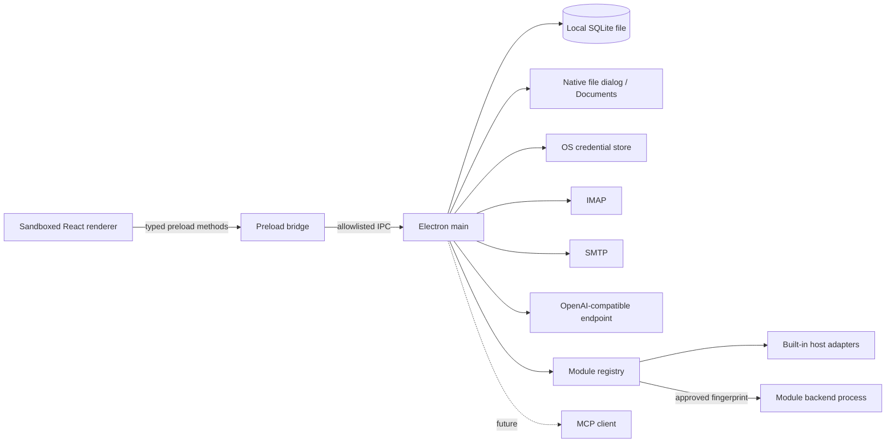

# Architektur und Umsetzungsplan

## Prozesse und Vertrauensgrenzen

Mail, Chat, Chatverwaltung, Entwurf, Dateien und Einstellungen laufen als einzelne Electron-Fenster; das Dock ist ein separates Fenster. Der Main-Prozess verwaltet den gemeinsamen Zustand und stellt den Renderern nur benannte Methoden über den Preload bereit. Die IPC-Aufrufe prüfen den Absender. Die Renderer laufen mit `contextIsolation` und Sandbox; Node-Integration ist abgeschaltet. Navigation und neue Fenster werden eingeschränkt.

### Markdown im Chat

Nutzer- und Assistentennachrichten werden mit `react-markdown` als CommonMark und mit `remark-gfm` für Tabellen, Aufgabenlisten, durchgestrichenen Text, automatische Links und Fußnoten dargestellt. Der gespeicherte Quelltext bleibt für Modellkontext, Kopieren und Chat-Abzweigungen unverändert. Codeblöcke sind kopierbar; breite Tabellen und Code scrollen innerhalb der Nachricht. Roher HTML-Code wird nicht ausgeführt.

Links behalten ihr tatsächliches Ziel und werden per Klick oder Tastatur geöffnet. Die typisierte Preload-Methode `openExternalLink` übergibt das Ziel an einen auf das Chatfenster beschränkten IPC-Handler. `shared/chat-links.ts` validiert im Renderer und erneut im Main-Prozess ausschließlich HTTP, HTTPS und `mailto`, ohne eingebettete Web-Zugangsdaten oder Steuerzeichen. `shell.openExternal` öffnet das Ziel in der Standard-App; das OVD-Fenster selbst navigiert nicht. Fragmentlinks und Fußnoten springen nur innerhalb derselben Nachricht. Entfernte Markdown-Bilder zeigen zunächst Alttext und Zielhost und werden erst nach „Bild laden“ ohne Referrer angefordert.

## Workspace-Assistent als Grundkonzept

Der OVD-Assistent ist ein gleichberechtigter Zugang zu allen implementierten Fachfunktionen von OpenVibeDesk. Er soll dieselben Aufgaben erledigen können, die über Mail, Entwürfe, Dateien, Fenster, Chats und Einstellungen erreichbar sind. Eine vollständige Integration umfasst sowohl Informationen und Navigation als auch das Vorbereiten und Ausführen zulässiger Änderungen. Eine neue UI-Funktion braucht daher zugleich ihren Assistenzzugang. Noch fehlende Werkzeuge sind Integrationslücken, keine beabsichtigte dauerhafte Produktgrenze.

Oberfläche und Assistent verwenden gemeinsame fachliche Dienste über benannte, typisierte und validierte Capabilities im Main-Prozess. Der angebotene Katalog beschreibt pro Capability Eingaben, Ressourcen-IDs, Voraussetzungen, Berechtigungen, erforderliche Nutzerfreigaben und mögliche Ergebnisse. Der Assistent erhält diese Fähigkeiten als begrenzte Werkzeuge; eine allgemeine Ausführung von Code oder beliebigen IPC-Nachrichten ist dafür nicht erforderlich. Aussagen über Fähigkeiten und ausgeführte Aktionen müssen dem angebotenen Katalog und dem tatsächlichen Ergebnis entsprechen.

Die konkrete Anbindung besteht aus diesen Teilen:

- [`electron/modules.ts`](../electron/modules.ts) entdeckt und validiert Manifeste, ordnet Funktionen einem Modul zu und bietet nur verfügbare Module zur Suche an. [`shared/modules.ts`](../shared/modules.ts) definiert die gemeinsamen Verträge für Metadaten, Beiträge und Funktionssuche.
- [`modules/ovd-assistant/module.json`](../modules/ovd-assistant/module.json) registriert das Pflichtmodul für Chat, Workspace, Fenster und Einstellungen. [`modules/ovd-mail/`](../modules/ovd-mail/) enthält das optionale Mailmodul mit eigenem Backend, Oberfläche und Manifest für Mail, Entwürfe, Kontoeinstellungen und Referenzen.
- [`modules/ovd-files/`](../modules/ovd-files/) enthält den optionalen Dateimanager mit eigenem Manifest, Dateidienst, Capabilities und Oberfläche. Dateien sind kein fester Navigationsbeitrag des Assistenten mehr; vorhandene Sortierpositionen mit der alten ID `files` werden nach `ovd-files:files` migriert.
- [`modules/ovd-mcp/`](../modules/ovd-mcp/README.md) enthält die optionale MCP-Werkzeuganbindung mit eigenem Einstellungsbereich, Konfiguration, Geheimnisspeicher und Transportschicht. Verbundene, freigegebene Server erscheinen über den allgemeinen `ModuleToolProvider` als kurze virtuelle Quellen; ihre Schemas werden erst gezielt geladen.
- [`electron/workspace-capabilities.ts`](../electron/workspace-capabilities.ts) beschreibt ausschließlich die Kernoperationen und stellt die gemeinsame Registry bereit. Optionale Module besitzen ihre eigenen Zod-Schemas und Beschreibungen, für Mail in [`modules/ovd-mail/backend/capabilities.ts`](../modules/ovd-mail/backend/capabilities.ts), und melden Definition samt Handler erst bei Aktivierung mit `registerDefinition` an. Die Hostadapter binden sie an dieselben Dienste für Oberfläche und Assistent. Der Aufrufkontext trägt Abbruchsignal, Chat und ausdrücklich ausgewählte Ressourcen-IDs; die Registry validiert Eingaben und begrenzt Ergebnisse.
- [`electron/agent-tools.ts`](../electron/agent-tools.ts) bietet anfangs ausschließlich `find_modules` und `get_module_tools`. [`electron/agent.ts`](../electron/agent.ts) hält gezielt geladene Funktionen nur während eines Auftrags bereit und akzeptiert pro Antwort ausschließlich tatsächlich angebotene Werkzeugnamen.
- [`electron/module-runtime.ts`](../electron/module-runtime.ts) startet freigegebene Fremdmodule über [`electron/module-worker.ts`](../electron/module-worker.ts) in separaten Prozessen. Der Host validiert ihre deklarierten Funktionen, prüft Zuständigkeit und Bestätigungen und bietet UI und Assistent denselben Aufrufweg.

### Modulstart und Kontextbudget

Die Appnavigation verwendet stabile Eintrags-IDs: `assistant`, `sessions`, `files`, `settings` sowie `moduleId:eintragsId` für Modulbeiträge. `Settings.navigationOrder` speichert eine optionale eigene Reihenfolge; `shared/navigation.ts` beschreibt die Kerneinträge und ordnet die Beiträge. Einstellung und Dock verwenden denselben Frontendkatalog. Deaktivierte oder vorübergehend nicht verfügbare Einträge behalten ihre Position, erscheinen aber nicht im Dock; neue Beiträge werden nach gespeicherten Einträgen ergänzt. Leere Reihenfolge bedeutet die Standardwerte der Beiträge. Aktivierung, Dateifingerprint-Freigaben und die Kategoriennavigation der Einstellungen werden dadurch nicht geändert.

`navigation.get` liefert den aktuellen verfügbaren Katalog seitenweise, `navigation.move` verschiebt einen Eintrag relativ zu einem anderen. Auch `settings.update` unterstützt die vollständige Reihenfolge beziehungsweise einen leeren Standard-Reset. Alle Wege verwenden dieselbe validierte Speicherung; unbekannte und doppelte IDs sowie unvollständige aktive Listen werden abgewiesen. Allgemeine Einstellungsänderungen werden serialisiert und erst nach erfolgreicher Speicherung veröffentlicht; ein Schreibfehler lässt den bisherigen Zustand sichtbar bestehen.

Beim Start liest OVD eingebaute Module aus `<appPath>/modules/` und eigene Module aus `<userData>/modules/`. Jedes Modul hat eine `module.json`; unbekannte API-Versionen, ungültige Manifeste oder widersprüchliche Registrierungen werden als Status mit Fehlergrund sichtbar. Fremdmodule führen beim bloßen Entdecken keinen Code aus. Unter **Einstellungen → Module** kann der Nutzer ihren Dateifingerprint ausdrücklich freigeben oder ein optionales Modul deaktivieren. Die Freigabe ist lokal in `module-settings.json` gespeichert und gilt nur für genau diesen Dateistand. Änderungen benötigen eine neue Freigabe. Deaktivierte Module bieten keine Werkzeuge, Navigation oder Einstellungsbeiträge an; ihre Daten bleiben erhalten. `ovd-assistant` bleibt aktiv.

Im Modellkontext stehen höchstens 20 kurze Modulbeschreibungen innerhalb eines Budgets von 6000 Zeichen sowie die zwei Entdeckungswerkzeuge. Beispiel „such nach hetzner“: `find_modules` findet mit der Fachfunktion „Mail“ das Modul; `get_module_tools` lädt gezielt die Suchfunktion; erst das danach angebotene Fachwerkzeug erhält „hetzner“ als Inhaltssuchbegriff. Entdeckung durchsucht Modul- und Funktionsbeschreibungen, niemals Mailinhalte. Beide Kataloge sind begrenzt und seitenweise abfragbar.

Modul- und Werkzeugtreffer werden nach Begriffsübereinstimmungen sortiert. Zusätzliche Wörter oder Zahlen dürfen einen passenden Treffer nicht ausblenden. Auch relevante Funktionen mit niedrigerem Rang bleiben über Folgeseiten erreichbar; `hasMore` beschreibt die gesamte passende Treffermenge. Fehlt eine Funktion unter einer engen Suchformulierung, kann der Assistent allgemeiner oder ohne Suchfilter weiterblättern, ohne alle Schemas vorab zu laden.

Geladene Eingabeschemas erscheinen ausschließlich in den Werkzeugdefinitionen der folgenden Anbieteranfrage. Das Entdeckungsergebnis enthält nur kurze Funktionsmetadaten. Unter Einstellungen → Agent sind Ausführung und Kontextbudgets konfigurierbar. Standardmäßig sind höchstens zwölf Fachwerkzeuge und 40.000 Zeichen für das gesamte Werkzeugangebot einschließlich der zwei Entdeckungswerkzeuge aktiv; weitere gezielte Auswahl verdrängt ältere Funktionen. Ein Lauf nutzt standardmäßig höchstens 25 Werkzeugrunden, 80 Aufrufe und 300 Sekunden. Die gesonderte Wartezeit pro Anbieteranfrage beträgt 60 Sekunden; im Streaming zählt die Wartezeit ohne neue Daten. Änderungen gelten erst für neue Aufträge. Eine Transportwiederholung ist standardmäßig erlaubt, ausschließlich für ungültige Antworten, deren Werkzeuge noch nicht ausgeführt wurden. Werkzeugkataloge und Ausführungsnachrichten liegen nur im Arbeitsspeicher dieses Laufs und werden nicht als Chatverlauf gespeichert. Ein neues Modul vergrößert daher den anfänglichen Werkzeugkatalog nicht.

### Gemeinsamer Basisvertrag: Zeit, Berechnungen und Abfragen

Jede Anbieteranfrage erhält einen kleinen aktuellen Hostkontext mit UTC-Zeit, lokalem Datum/Zeitpunkt samt Offset, IANA-Zeitzone und Locale. Dies gilt auch bei abgeschalteten Workspace-Werkzeugen; die Zeit wird nicht aus alten Chat- oder Maildaten abgeleitet. `context.get` liefert zusätzlich aktuelle Zeit, Workspace-Zugriffs-/Bestätigungsmodus und die vorhandene aktive Auswahl. Die bei Bedarf nachgeladenen Funktionen `time.now`, `time.resolve_range` und `time.difference` aktualisieren Zeit und berechnen Kalendergrenzen oder Zeitdifferenzen. `shared/time.ts` verwendet Temporal mit expliziter Zeitzone; Tage können beim Sommerzeitwechsel 23 oder 25 Stunden haben. Wochen beginnen montags; `last_7_days`/`last_30_days` schließen heute ein. Zeiträume sind immer am Anfang eingeschlossen und am Ende ausgeschlossen.

`math.calculate` verarbeitet begrenzte Summen, Mittelwerte, Produkte, Differenzen, Division, Prozentanteile, Minimum und Maximum. Dezimalwerte werden als BigInt-Brüche verarbeitet; das Ergebnis nennt Rundung und Genauigkeit ausdrücklich. Es gibt weder `eval` noch einen allgemeinen Code- oder SQL-Zugang. Alle zusätzlichen Werkzeugschemas bleiben wie andere Modulfunktionen hinter der gezielten Entdeckung.

Das Mailmodul verwendet für `mail.query` und `mail.count` dieselben AND-kombinierbaren Filter aus `shared/mail-query.ts`: Suchtext, Absender, Empfänger, Betreff, Gelesen-Status und Empfangszeitraum. Standard ist der Posteingang des aktiven oder ersten Kontos; weitere oder alle Konten/Ordner sind ausdrücklich wählbar. Die Oberfläche bietet dieselben Dienste unter **Filter & Anzahl** mit „Mails anzeigen“ und „Nur Anzahl“. Die dortige Zählung bezieht sich auf den Serverumfang, nicht bloß auf die geladenen Listeneinträge. Bereits vorhandene lokale Ansichtsfilter sind als Filter geladener Nachrichten kenntlich.

Zählungen übertragen keine Mailtexte und keine einzelnen Nachrichten an das Modell. Für reine Serverfilter nutzt der Dienst ESEARCH COUNT beziehungsweise SEARCH als Fallback. Empfangszeitfilter verwenden einen breiten IMAP-Tagesvorfilter und prüfen anschließend die tatsächliche INTERNALDATE mit präzisen UTC-Grenzen; Absenderdatum und Empfangszeit sind getrennt. Datumsreihenfolgen werden über alle passenden Kandidaten innerhalb des ausgewiesenen Metadatenbudgets berechnet. Pro Ordner werden höchstens 10.000 Kandidaten-Metadaten geprüft, pro Abfrage höchstens 50 Ordner. Erreichte Grenzen, fehlende Datumswerte, nicht erreichbare Ordner und Zeitstempel stehen im Ergebnis. `countExact` kennzeichnet eine verlässliche Anzahl; `complete` bezeichnet die Vollständigkeit der Erhebung beziehungsweise Sortierung. Untergrenzen dürfen nicht als Gesamtzahl dargestellt werden. Kopien in verschiedenen Ordnern zählen als einzelne Ordnereinträge und werden entsprechend ausgewiesen.

Abfragelisten enthalten höchstens 20 Metadaten pro Seite, Standard zehn. Der Host sortiert mehrere Ordner gemeinsam und verwendet kurzlebige, filter-/umfangsgebundene Cursor; nur tatsächlich ausgegebene Einträge werden pro Ordner weitergeschoben. Änderungen an Konto, UIDVALIDITY, Serverkandidaten oder Filtern verlangen einen Neustart der Abfrage. Ergebnis-IDs erhalten dieselbe begrenzte Freigabe für gezieltes Lesen oder Öffnen wie andere Mailergebnisse. Die gespeicherte allgemeine Mailfreigabe bleibt unverändert; Abbruch einer Einzelfreigabe erfolgt vor dem Abrufen von Ordnern und Nachrichten.

### Agent-Einstellungen und Grenzen

`WorkspaceState.agentSettings` enthält unabhängige Einstellungen für den Assistenten. Sie lassen sich auch ohne eingerichteten KI-Anbieter speichern und verändern weder Anbieter noch Modell, Freigaben oder Bestätigungsmodus. `shared/agent-settings.ts` hält Standardwerte, Wertebereiche und Validierung zentral. `settings.agent_get` liest die tatsächlich gespeicherten Werte; `settings.agent_save` bereitet Änderungen im Formular vor. Erst die Nutzeraktion zum Speichern übernimmt sie. Ein laufender Auftrag erhöht seine Grenzen nicht selbst.

| Einstellung | Standard | Bereich |
| --- | --- | --- |
| Werkzeugrunden | 25 | 1–100 |
| Werkzeugaufrufe inklusive Entdeckung | 80 | 1–500 |
| Gesamtlaufzeit des Agenten | 300 Sekunden | 15–1800 |
| Anbieterwartezeit pro Chat-/Werkzeugantwort | 60 Sekunden | 5–600 |
| Gleichzeitig aktive Fachwerkzeuge | 12 | 1–24 |
| Serialisiertes Werkzeugangebot inklusive Schemas | 40.000 Zeichen | 8.000–80.000 |
| Ältere Nachrichten im Kontext | 30 | 0–100 |
| Textbudget für ältere Nachrichten inklusive ihrer Referenzen | 60.000 Zeichen | 0–200.000 |
| Zusätzliche Versuche bei fehlerhafter Werkzeugantwort-Übertragung | 1 | 0–2 |

Ältere Nachrichten werden als ganze Nachrichten vom Anfang des berücksichtigten Verlaufs ausgelassen; die aktuelle Nachricht mit ihren ausdrücklich ausgewählten Mail-/Chatreferenzen bleibt erhalten. Null bedeutet für die beiden Verlaufsbudgets, dass kein älterer Verlauf eingefügt wird. Ausgelassener Verlauf wird im Providerkontext kurz kenntlich gemacht. Zeichenbudgets sind keine Tokenzählung. Modulwerkzeuge und deren Ergebnisse bleiben weiterhin aufgabenbezogen begrenzt.

Beim Erreichen einer Grenze beendet sich der Auftrag mit Status `limited` und `agentRunLimit`: Grund, verwendete Runden/Aufrufe, davon Entdeckung und Fachaktionen, Dauer und ausstehender Schritttyp. Bereits ausgeführte Änderungen und protokollierte Statusangaben bleiben erhalten; rohe Werkzeugantworten gehören weiterhin zum Arbeitsspeicher des jeweiligen Laufs. In einer angefragten Batch werden nur die noch zulässigen Aufrufe gestartet; ein gestoppter Auftrag startet nach einer Einstellungsänderung nicht automatisch erneut. Läuft beim Ablauf eines Zeitlimits noch eine unbestätigte Aktion, wird deren Ergebnis als unklar gekennzeichnet und muss geprüft werden; es erfolgt kein automatischer neuer Versuch. Der Chat bietet einen direkten Sprung zur Agent-Konfiguration.

### Bestätigungen und tatsächliche Werkzeugergebnisse

`AiConfig.confirmationMode` ist standardmäßig `ask`. Die ausdrücklich gespeicherte Option `never` („Ohne Abfragen“) überspringt einzelne Bestätigungsdialoge nur für angeforderte Assistentenaktionen mit `origin: agent`; direkte UI-Aktionen behalten ihre Bestätigung. Zentral entscheidet `confirmCapability` im Host. Die Einstellung erweitert keine Dateizugriffe oder allgemeinen Postfachrechte und führt keine Aufträge eigenständig aus. Die einmalige Zustimmung zu einer konkreten Postfachsuche kann im direkten Modus ohne Dialog gelten; die allgemeine Mailfreigabe wird dabei nicht verändert. Neue oder geänderte Fremdmodule benötigen unabhängig vom Modus eine eigene Dateifingerprint-Freigabe. Der Assistent kann die Moduseinstellung nur im Formular vorbereiten; wirksam wird sie durch den Nutzer beim Speichern.

Fachaktionen können `outcome: completed | failed | cancelled | uncertain` mit kurzen Meldungen liefern. Der Host nutzt dieselbe Interpretation für das Werkzeugergebnis und die gespeicherte Aktivitätsanzeige. Leere `error`-Werte sind kein Fehlschlag. Explizite Nicht-Erfolge beenden den aktuellen Aktionslauf mit der Hostmeldung; weitere Aufrufe und eine widersprechende Modellantwort werden verhindert. Spekulativer Text aus einem Werkzeugturn wird vor der Ausführung zurückgenommen, während reine Antwortturns weiter streamen. Bei SMTP bedeutet `sent` ausschließlich die bestätigte Annahme durch den Server. `uncertain` und bereits angenommene Nachrichten sperren automatische Wiederholungen; Teilablehnungen und lokale Speicherprobleme nach Annahme werden getrennt als Warnungen behandelt.

### Vertrag für Fremdmodule

Ein Prozessmodul liefert vorbereiteten JavaScriptcode mit `activate({ moduleId, dataDirectory })`. Das Ergebnis enthält genau die im Manifest beschriebenen Funktionen als `tools` und optional `dispose()`. Alle Funktionen des Moduls müssen sowohl über seine Oberfläche als auch über den Assistenten erreichbar sein. Der Host erzeugt für den KI-Anbieter gültige Werkzeugnamen und hält die Zuordnung zu Modul und Manifestfunktion selbst. Eigene HTML-Ansichten und Einstellungen laufen in isolierten iframes und können über eine begrenzte Nachrichtenbrücke ausschließlich Funktionen ihres Moduls aufrufen.

Der Backendprozess isoliert Fehler, ist aber **keine Betriebssystem-Sandbox**: freigegebener Modulcode hat normale Benutzerrechte. Die deklarierte Berechtigungsliste beschreibt beabsichtigte Zugriffe und erzwingt keine OS-Grenzen. Nur vertrauenswürdiger lokaler Code darf freigegeben werden. Der Host begrenzt Startzeit, Aufrufdauer, Parallelität und JSON-Größen; er führt fehlgeschlagene Aufrufe nicht automatisch erneut aus. Eigene Daten liegen getrennt unter `<userData>/module-data/<moduleId>/`. Der vollständige [Entwicklervertrag](../CONTRIBUTING.md#eigene-module) und das [Notizbeispiel](../examples/notes-module/README.md) beschreiben Manifest, Lebenszyklus, UI-Brücke und praktische Prüfung.

| Funktionsgruppe | Angebotene Abläufe |
| --- | --- |
| Kontext und Fenster | Aktive Mail, Referenzen und Entwurf bestimmen; Workspace-Fenster auflisten, öffnen, fokussieren, minimieren, maximieren und schließen |
| Entwürfe | Auflisten, lesen, neu erstellen oder beantworten, öffnen und Felder ändern; Versand mit Nutzerbestätigung anfragen |
| Mail | Konten und Ordner anzeigen, Nachrichten seitenweise laden, serverseitig suchen, Ansicht und Suchtreffer navigieren und filtern, ausgewählte Mail lesen/öffnen, Gelesen-Status ändern und Anhang speichern |
| Dateien | Dokumente-Bereich anzeigen und öffnen, Dateien ausdrücklich auswählen, an Entwürfe anhängen und Anhänge entfernen |
| Chats | Auflisten, gespeicherten Verlauf seitenweise lesen, erstellen, öffnen, umbenennen, referenzieren und abzweigen; eingerichtetes Modell für folgende Nachrichten wählen |
| Einstellungen und Konten | Darstellung ändern, Einstellungsbereiche öffnen, öffentliche KI-/SMTP-Konfiguration lesen und Verbindungen prüfen; geschützte Formulare vorbereiten, Schlüssel oder lokale Konten mit Bestätigung entfernen |
| App | Beenden über den sichtbaren Bestätigungsablauf anfragen |

`settings.ai_save`, `accounts.save` und `smtp.save` bereiten die jeweiligen geschützten Einstellungsformulare mit öffentlichen Angaben vor. Der Nutzer ergänzt Geheimnisse ausschließlich in der Oberfläche und löst dort das endgültige Speichern aus. `accounts.save` bereitet neue IMAP-Konten oder mit `accountId` die Bearbeitung eines vorhandenen Kontos vor. IMAP und SMTP stehen in derselben Kontogruppe; der Assistent öffnet das passende Formular, der Nutzer prüft und speichert. Updates behalten die Konto-ID und damit SMTP- und Entwurfszuordnungen. Leere Passwortfelder bei unveränderter Verbindung behalten das gespeicherte Passwort. Bei einem Wechsel von IMAP-Server oder Anmeldung wird ausdrücklich ein neues Passwort benötigt. SMTP mit gemeinsamen Zugangsdaten verwendet stets den aktuellen IMAP-Benutzernamen und dessen gespeichertes Passwort.

Der Hauptablauf ist beispielsweise: Der Nutzer referenziert eine Mail und bittet um eine neue Nachricht an deren Absender. Die Referenz wird im Main aufgelöst, die Absenderadresse aus den bekannten Maildaten übernommen, derselbe Entwurfsdienst wie in der Oberfläche aufgerufen und der neue Entwurf mit dem gewünschten Empfänger geöffnet. Der Assistent prüft das Ergebnis und meldet die konkrete Änderung. Für eine Antwort wird stattdessen die fachliche Antwortfunktion mit Reply-To und Gesprächsbezug verwendet.

Die ausdrücklich im Chat referenzierte oder aktuell im Mailfenster ausgewählte Nachricht ist für den zugehörigen Auftrag gezielt zugänglich; dafür ist keine allgemeine Postfachfreigabe erforderlich. Weitergehende Abfragen von Postfachordnern und Nachrichten beachten die allgemeine Mail-Werkzeugfreigabe. Für eine konkrete serverseitige Suche kann der Nutzer alternativ eine einmalige sichtbare Zustimmung zu Suchbegriff, Konten und Übertragung der Treffer-Metadaten an den gewählten KI-Anbieter erteilen. Dies verändert die allgemeine Einstellung nicht. Gefundene Mails sind für den zugehörigen Auftrag gezielt nutzbar; Text wird bei Bedarf vom Server nachgeladen. Das Beispielpostfach ist in der Oberfläche nicht mehr verfügbar; intern vorhandene Beispieldaten bleiben erhalten, werden aber von den Mail-Werkzeugen des Chats nicht durchsucht. Auf ausdrücklichen Auftrag kann er für eine freigegebene echte Nachricht einen lokal gespeicherten Antwortentwurf erstellen und öffnen. Auch weitergehende Fachfunktionen müssen über denselben Capability-Zugang bereitgestellt werden; der tatsächliche Umfang ergibt sich aus dem angebotenen Katalog. Das Öffnen einer echten Mail markiert sie nicht als gelesen. Die Auswahl und Ausführung der Werkzeuge erfolgt im Main-Prozess; das Modell erhält nur die jeweils angebotenen Werkzeuge und ihre Ergebnisse. Mailinhalte sind Daten aus einer nicht vertrauenswürdigen Quelle und können Anweisungen enthalten. Ihre Kennzeichnung allein garantiert keinen Schutz vor Prompt Injection.

Eine vom Nutzer in den Chat gezogene Mail ist ein ausdrücklich ausgewählter Kontext für eine Nachricht. Der Drag-Payload enthält nur eine Ressourcen-ID; der Main-Prozess prüft sie gegen die bekannten Nachrichten und liefert Metadaten an den Chat. Beim Senden löst er den Inhalt auf und erstellt eine begrenzte Momentaufnahme für die Chatnachricht. Der Renderer kann keinen beliebigen Mailtext als vertrauenswürdige Referenz einschleusen. Die Auswahl einer einzelnen Mail erteilt keine allgemeine Postfachfreigabe; die Mail-Werkzeuge behalten ihre gesonderte Einstellung.

Die gemeinsame Chatoberfläche nennt das Hinzufügen neutral „Referenz“ und verwendet ein Referenzsymbol. Erst ein bestimmter Referenz-Chip, dessen Entfernen oder ein zugehöriger Datenschutzhinweis nennt den tatsächlichen Typ. Der Ablagehinweis erscheint bei den unterstützten Mail-/Chat-Dragformaten; gewöhnlicher Text wird dadurch nicht als Referenz angeboten. Die bestehenden Textpräfixe bleiben beim tatsächlichen Drop als Fallback erhalten. Der aktive Chat kann sich nicht selbst referenzieren und ist im Chatmanager nicht ziehbar.

Chatreferenzen behalten ihre stabile Chat-ID auch im Modellkontext. Neue Momentaufnahmen nennen Erfassungszeit, letzten Änderungsstand, Nachrichtenanzahl und Kürzung; bei älteren gespeicherten Referenzen bleibt die Vollständigkeit ausdrücklich unbekannt. Der Vorschautext bleibt auf 20.000 Zeichen begrenzt und löst verschachtelte Referenzen nicht auf. Benötigt ein Auftrag mehr oder den aktuellen Stand, entdeckt der Assistent `chats.read` im Pflichtmodul und liest den gespeicherten Verlauf über die Chat-ID seitenweise. Einzelne lange Nachrichten werden in fortsetzbare Textteile zerlegt. Ein Fortsetzungscursor gehört zum konkreten Inhaltsstand; Änderungen verlangen einen neuen Abruf. Das Lesen öffnet oder wechselt kein Chatfenster; `chats.open` bleibt die eigene Navigationsfunktion. Die Werkzeugdefinition wird wie andere Fachfunktionen erst bei Bedarf geladen.

### Optionales Dateienmodul

`ovd-files` bietet `files.list`, `files.open`, `files.choose`, `files.read` und `files.reference`. Dateimanager und Assistent verwenden denselben Dienst. Listen lassen sich im aktuellen Ordner nach Namen filtern und nach Name, Größe oder Änderung sortieren; Ergebnisse sind paginiert und passen in das gemeinsame Werkzeugbudget. `files.open` navigiert den Dateimanager und wählt eine Datei aus, ohne Programme auszuführen. Die Oberfläche zeigt eine Textvorschau, Metadaten und einen Weg zum Referenzieren oder zum Anhängen an einen aktiven Mailentwurf.

Der Dokumente-Ordner ist der Startpunkt; Dateimanager und Assistent können alle lokalen Dateien und Ordner innerhalb der Betriebssystemrechte verwenden. Eine zusätzliche Pfadfreigabe oder vorherige Auswahl ist nicht erforderlich. Die editierbare Pfadleiste, Breadcrumbs und „Übergeordneten Ordner öffnen“ navigieren bis zur Dateisystemwurzel. Der Dateidienst löst tatsächliche Pfade auf und prüft sie bei jedem Zugriff; stabile IDs bleiben durch lokale Pfadmetadaten nach einem Neustart wiederherstellbar. Der gemeinsame native Datei-Picker für Mailanhänge bleibt auch ohne Dateimanager nutzbar.

UTF-8-Textdateien wie TXT, Markdown, Quellcode, JSON und CSV bis 2 MiB können über versionsgebundene Cursor vollständig gelesen werden. PDF, Office, Bilder, Binärdateien und größere Texte liefern vorerst Metadaten mit einem erklärten Grund. Diese Formate werden nicht als gelesener Inhalt dargestellt. Die Momentaufnahme einer Dateireferenz enthält höchstens 4000 Zeichen und nennt Kürzung, Lesbarkeit und Stand; mehr Text lädt der Assistent nur bei Bedarf mit `files.read`.

`shared/references.ts` definiert allgemeine Modulreferenzen. Drag-Daten enthalten nur Modul-ID, Referenztyp und Ressourcen-ID. `electron/module-references.ts` verbindet registrierte, verfügbare Modulresolver mit dem Chat, validiert Identität und begrenzte Rückgaben und lässt das zuständige Backend die Momentaufnahme erstellen. Der Chat besitzt keine dateispezifische Auflösung. Referenzen bleiben in Entwürfen, Sende-Wiederherstellung, Verlauf und Abzweigungen erhalten. Bei deaktiviertem Modul verschwinden Ansicht, Navigation und Werkzeuge; vorhandene gespeicherte Momentaufnahmen bleiben lesbar. Neue Inhaltszugriffe benötigen das aktive Modul.

Das Schema für strukturierte `UiAction`-Objekte umfasst unter anderem Fenster-, Entwurfs-, Datei- und Mailaktionen. Es bildet einen bisherigen Teil der Implementierung ab und ist keine abschließende Liste der erlaubten Assistenzfunktionen. Die Integration muss die vorhandenen UI-Funktionen mit den angebotenen Capabilities abgleichen und Lücken schließen. Eingaben und Ressourcen-IDs werden am gemeinsamen Diensteinstieg validiert; die ausgeführte Aktion liefert ein nachvollziehbares Ergebnis.

Versand, destruktive Änderungen und sicherheitsrelevante Einstellungen werden über einen vorbereiteten Ablauf mit sichtbarer Nutzerfreigabe angeboten. Der Assistent darf diesen Ablauf anstoßen und dem Nutzer die konkrete Wirkung zur Prüfung vorlegen. Die endgültige Wirkung erfolgt erst nach der erforderlichen Freigabe; ein Modellwerkzeug darf sie nicht umgehen. Geheimnisse werden nicht an das Modell ausgegeben: Der Assistent kann den passenden Einrichtungsdialog öffnen und zulässige Metadaten verwalten, während Passwort- und Schlüsselangaben im vorgesehenen sicheren Ablauf bleiben. Fehlende Berechtigung, ausstehende Freigabe, abgebrochene Aktion und erfolgreiche Ausführung müssen unterscheidbar sein.

## Zustandsmodell

`WorkspaceState` umfasst unter anderem Fensterpositionen, Beispiel-Mails, Mailentwürfe, Einstellungen und Chat-Sessions. Er liegt als JSON-Wert in einer lokalen SQLite-Tabelle. Noch nicht abgesendete Chattexte werden gesondert im lokalen Speicher des Renderers gehalten. Die SQLite-Datei ist derzeit nicht verschlüsselt; sie darf nicht als verschlüsselter Datenspeicher verstanden werden. Auch wenn abgerufene IMAP-Nachrichten nur im Arbeitsspeicher zwischengespeichert werden, können lokal gespeicherte Entwürfe, ausdrücklich gesendete Mailreferenzen und Chatantworten echte Mailinhalte enthalten. Eine Mailreferenz speichert einen begrenzten Textauszug und Metadaten als Momentaufnahme, damit der Kontext im Verlauf und bei einer Chat-Abzweigung auch nach einem Neustart erhalten bleibt. Heruntergeladene Anhänge werden am vom Nutzer gewählten Ort gespeichert.

Vor einem dauerhaften Mail-Cache ist ein relationales Schema mit Tabellen für Konten, Ordner, Nachrichten, MIME-Parts, Threads, Entwürfe, Attachments und Sync-Cursor vorgesehen. Migrationen sollen versionsweise und transaktional ausgeführt werden. Große Dateianhänge gehören in verwaltete lokale Dateien; SQLite hält dann Metadaten und Referenzen.

## Mail-Pipeline

1. **Vorhanden:** IMAP-Konto anlegen, Verbindung prüfen und Zugangsdaten im OS-Keychain speichern. Eine lokale Kontodatei enthält Metadaten ohne Passwort. Ordner und Nachrichten werden bei Bedarf in Seiten zu bis zu 25 geladen; der Cursor verwendet UID und UIDVALIDITY. Die Ansicht zeigt bis zu 500 Nachrichten gleichzeitig. Der Nachrichtentext folgt erst auf Abruf. Anhänge können einzeln über einen Speicherdialog heruntergeladen werden. Nachrichten lassen sich ausdrücklich als gelesen oder ungelesen markieren; das Öffnen allein ändert den Status nicht. TLS direkt oder verpflichtendes STARTTLS mit Zertifikatsprüfung schützen die Verbindung.
2. **Vorhanden:** Textentwürfe werden lokal gespeichert und können Anhänge referenzieren. Für SMTP ist eine separate Einrichtung je Konto erforderlich; vor jedem Versand bestätigt der Nutzer den Vorgang. Die App zeigt einen unklaren Versandstatus an, wenn die Serverannahme nicht sicher feststeht, und verhindert ein direktes erneutes Senden desselben Entwurfs. Eine SMTP-Annahme ist keine Zustellbestätigung und die App garantiert keine Ablage im Gesendet-Ordner. Die Assistentenanbindung für den Versand muss denselben sichtbaren Bestätigungsschritt verwenden; eine automatische Freigabe durch das Modell ist ausgeschlossen.
3. **Geplant:** Vollständige IMAP-Synchronisierung mit dauerhaftem Cache, Delta-Sync und Wiederverbindung sowie ein Schutzkonzept für ruhende Maildaten. Ein dauerhafter lokaler Volltextindex fehlt; die zusätzliche Serversuche bleibt pro Auftrag begrenzt.
4. **Geplant:** HTML-Nachrichten in einer isolierten, restriktiven Ansicht sicher darstellen: keine Skripte, aktiven Inhalte oder automatische Remote-Bilder. Links nur nach Benutzeraktion öffnen. Derzeit wird Text angezeigt.
5. **Geplant:** Thread-Zuordnung über `Message-ID`, `In-Reply-To` und `References` sowie erweiterte Entwurfs- und Mailfunktionen.

Die IMAP-Ansicht hält abgerufene Nachrichten während der Sitzung im Speicher. Eine ausdrücklich ausgewählte Chatreferenz oder aktive Mail ist gezielter Kontext für den Auftrag. Die lokale Ansicht filtert geladene Metadaten und Texte; die nachfolgend beschriebene Serversuche ergänzt diesen Bestand innerhalb ihres ausgewiesenen Umfangs. Beim Lesen einer ausgewählten oder freigegebenen Nachricht kann ihr Text bei Bedarf vom Server nachgeladen werden.

### Serversuche und Suchansicht

Die Capability `mail.search`, ihr bei Bedarf geladenes Modellwerkzeug und die Serversuche der Mailoberfläche rufen denselben Dienst des Mailmoduls auf. Die IMAP-Suche fragt serverseitigen Nachrichtentext ab und lädt anschließend nur die Metadaten passender Nachrichten. Sie verwendet UID und UIDVALIDITY für die Identität; Treffertexte und Anhänge werden weiterhin erst bei Bedarf geladen. Ohne angegebene Konto-ID gilt das aktive Konto, sofern vorhanden, ansonsten die bekannten Konten; ein expliziter Ordner begrenzt die Suche zusätzlich.

Für „die letzten zehn Mails insgesamt“ steht `mail.list_messages` unabhängig von einer Begriffssuche bereit. Ohne Konto gilt das aktive, ansonsten das zuerst eingerichtete Konto; ohne Ordner gilt dessen Posteingang. Frühere Suchbegriffe und lokale Ansichtsfilter werden nicht übernommen. `limit` liefert standardmäßig zehn, höchstens zwanzig Metadaten; ältere Nachrichten sind mit `nextCursor` bei gleichem Konto und Ordner abrufbar. Die Oberfläche und das Werkzeug verwenden denselben IMAP-Metadatendienst; die UI lädt weiterhin standardmäßig 25 Nachrichten. Das Ergebnis nennt Konto, Ordner, Anzahl, tatsächlichen Umfang und Sortierung nach absteigender Server-UID. Das ist die Aufnahmefolge im gewählten Ordner, keine vollständige Datumsrangliste über alle Konten und Ordner. Das Absenderdatum `date` bleibt erhalten; `receivedAt` enthält bei Verfügbarkeit die IMAP-Serverzeit. Nachrichtentexte und Anhangdateien werden für die Auflistung nicht geladen, der Gelesen-Status bleibt unverändert.

Ohne allgemeine Mailfreigabe kann die Auflistung wie eine konkrete Suche einmalig freigegeben werden; im ausdrücklich gespeicherten Modus „Ohne Abfragen“ entfällt dieser einzelne Dialog. Eine Ablehnung beendet den Aufruf mit `cancelled`, bevor Ordner oder Nachrichten abgerufen werden. Nur die IDs der begrenzten Ergebnisliste werden für anschließendes gezieltes Lesen oder Öffnen im selben Chat freigegeben. Andere Mail-IDs und die allgemeine Freigabeeinstellung werden dadurch nicht freigegeben.

Pro Auftrag werden höchstens zehn auswählbare Ordner durchsucht und höchstens 50 Treffer angezeigt. `scope`, `foldersSearched`, `foldersRemaining`, `hasMore` und eventuelle Warnungen beschreiben die tatsächliche Abdeckung. Weitere oder nicht erreichbare Ordner dürfen nicht als vollständig durchsucht dargestellt werden. Suchresultate erscheinen als eigene Ergebnisliste im vorhandenen Mailfenster mit Konto-/Ordnerbezug; Lesen, Gelesen-Status, Antworten, Anhänge und Drag & Drop verwenden die bestehenden Fachfunktionen weiter. Die Oberfläche bleibt eine gemeinsame Mailansicht mit Suchkopf, kompakter Aktionsleiste, Ordnernavigation und Lesebereich.

Bei ausgeschalteter allgemeiner Mailfreigabe erscheint vor einer Assistenz-Serversuche ein sichtbarer, auf diesen Auftrag begrenzter Zustimmungsdialog. Er nennt Suchbegriff, Konten und den KI-Anbieter als Empfänger der Treffer-Metadaten. Ablehnung führt zu keiner Serversuche und aktiviert keine Berechtigung. Die allgemeine Freigabe wird auch nach Zustimmung nicht still geändert. Eine bewusst in der Mailoberfläche gestartete Suche zeigt ihre Ergebnisse zunächst lokal; daraus folgt keine eigenständige allgemeine KI-Freigabe.

## LLM- und MCP-Pipeline

Der derzeitige Provider im Main-Prozess unterstützt OpenAI-kompatible Endpunkte: `/models` für die Modellliste und `/chat/completions` für Antworten als SSE-Stream. Für die standardmäßig aktivierten Workspace-Werkzeuge muss der Endpunkt außerdem OpenAI-kompatible Werkzeugaufrufe unterstützen; sie lassen sich in den KI-Einstellungen ausschalten. Der Chat hat zwei frei konfigurierbare Modellplätze mit je einer Thinking-Stufe. HTTP ist nur für Loopback-Adressen erlaubt, Weiterleitungen werden nicht automatisch verfolgt. Der Chat unterstützt Abbruch und speichert empfangene Teilantworten.

Der API-Schlüssel wird im Einstellungsfenster eingegeben und über die typisierte Preload-Schnittstelle an den Main-Prozess übermittelt. Dieser speichert und liest ihn im Zugangsdaten-Speicher des Betriebssystems. Bereits gespeicherte Schlüssel werden dem Renderer nicht zurückgegeben und nicht absichtlich in Modellprompts aufgenommen. Nachrichten, Chatverlauf, ausgewählte Referenzen und Ergebnisse der vom Modell angeforderten Werkzeuge werden an den konfigurierten Endpunkt gesendet. Bei einer Mail-Suche oder beim Lesen können somit auch Mailinhalte übermittelt werden. Referenzierte Chats werden als begrenzte Momentaufnahme ohne rekursive Auflösung eingefügt; Mail- und Chatinhalt wird als nicht vertrauenswürdiger Kontext gekennzeichnet.

Das optionale Modul `ovd-mcp` verbindet gespeicherte Server über Stdio oder Streamable HTTP. Server- und Werkzeugfreigaben liegen im eigenen MCP-Einstellungsbereich, Geheimnisse im OS-Schlüsselspeicher. Verbundene freigegebene Server werden über `ModuleToolProvider` zu virtuellen Quellen in derselben Entdeckung wie andere Module. Der Host prüft Parentstatus, konkrete Schemaangebote und laufende Aufrufe; der Provider prüft Verbindung, aktuelle Berechtigungen und Eingaben vor der Ausführung. Alte Namen sind nach einer Änderung nicht stillschweigend weiter aufrufbar. Serveranweisungen werden nicht als Systemprompt übernommen. Die erste Stufe umfasst Werkzeuge und ein begrenztes Sitzungsprotokoll; OAuth, MCP-Ressourcen und Prompts folgen. Details stehen im [MCP-Modul](../modules/ovd-mcp/README.md).

Weitere KI-Provider und ein durchgängiges dauerhaftes Action-Protokoll sind vorgesehen. Noch fehlende Workspace-Werkzeuge werden als Teil der jeweiligen Fachfunktion ergänzt. Die allgemeine Mailfreigabe gilt für zusätzliche Postfachabfragen; der gezielte Zugriff auf eine ausdrücklich referenzierte oder aktive Mail bleibt davon getrennt. Neue Zugriffsarten müssen passende Berechtigungen und Datenschutzgrenzen mitbringen.

## Prüfung

Die Produktvorgaben stehen im [Mail-Leitfaden](mail-design.md), im [Settings-Konzept](settings-design.md) und in `AGENTS.md`. Funktionen werden zunächst praktisch in der App geprüft. Bei Oberflächenumbauten gehören bestehende Abläufe über Fenstergrenzen, insbesondere Mail-Drag & Drop und die tatsächliche Verwendung der Referenz im Chat, zur Prüfung. Jeder neue UI-Ablauf wird außerdem als konkreter Nutzerauftrag durch den OVD-Assistenten ausgeführt; erforderliche Berechtigungen und Freigaben gehören zum selben Ablauf. TypeScript und Vite lassen sich lokal bauen. Für reale Mail und weitere Agent-Integrationen wird die notwendige Prüfung passend zum jeweiligen Funktionsumfang festgelegt.
