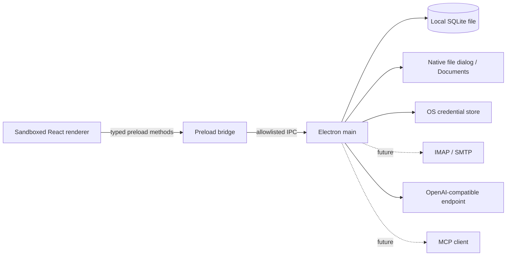

# Architektur und Umsetzungsplan

## Prozesse und Vertrauensgrenzen

Mail, Chat, Chatverwaltung, Entwurf, Dateien und Einstellungen laufen als einzelne Electron-Fenster; das Dock ist ein separates Fenster. Der Main-Prozess verwaltet den gemeinsamen Zustand und stellt den Renderern nur benannte Methoden über den Preload bereit. Die IPC-Aufrufe prüfen den Absender. Die Renderer laufen mit `contextIsolation` und Sandbox; Node-Integration ist abgeschaltet. Navigation und neue Fenster werden eingeschränkt.

Das Schema für strukturierte `UiAction`-Objekte umfasst `open_window`, `focus_window`, `read_email`, `create_draft`, `update_draft`, `open_file_manager`, `attach_file` und `request_user_input`. Ein Agenten- oder Tool-Calling-Loop ist noch nicht implementiert. Künftige Modellaktionen müssen im Main-Prozess gegen Schema, Herkunft, Berechtigung und Ressourcen-ID geprüft werden. Versand und Löschen sind keine Agent-UI-Aktionen.

## Zustandsmodell

`WorkspaceState` umfasst unter anderem Fensterpositionen, Mock-Mail, Mailentwürfe, Einstellungen und Chat-Sessions. Er liegt als JSON-Wert in einer lokalen SQLite-Tabelle. Noch nicht abgesendete Chattexte werden gesondert im lokalen Speicher des Renderers gehalten. Die SQLite-Datei ist derzeit nicht verschlüsselt; sie darf nicht als verschlüsselter Datenspeicher verstanden werden.

Vor IMAP ist ein relationales Schema mit Tabellen für Konten, Ordner, Nachrichten, MIME-Parts, Threads, Entwürfe, Attachments und Sync-Cursor vorgesehen. Migrationen sollen versionsweise und transaktional ausgeführt werden. Große Dateianhänge gehören in verwaltete lokale Dateien; SQLite hält dann Metadaten und Referenzen.

## Mail-Pipeline (nächster Schritt)

1. Konto anlegen, Zugangsdaten ausschließlich im OS-Keychain speichern; SQLite hält Kontometadaten.
2. IMAP pro Konto in einem Main-Prozess-Service synchronisieren (UIDVALIDITY, UID, Flags, Ordner, Delta-Sync, Wiederverbindung).
3. MIME-Nachrichten parsen; Text und HTML getrennt halten. HTML in einer isolierten, restriktiven Ansicht sanitizen: keine Skripte, aktiven Inhalte oder automatische Remote-Bilder. Links nur nach Benutzeraktion öffnen.
4. Thread-Zuordnung über `Message-ID`, `In-Reply-To` und `References`; Ordner und Suchindex lokal abbilden.
5. Entwürfe lokal autospeichern, Anhänge in verwaltetem Speicher referenzieren; SMTP nur nach expliziter Benutzerfreigabe auslösen. Agenten können vorbereiten, aber nicht eigenständig senden, verschieben oder löschen.

## LLM- und MCP-Pipeline

Der derzeitige Provider im Main-Prozess unterstützt OpenAI-kompatible Endpunkte: `/models` für die Modellliste und `/chat/completions` für Antworten als SSE-Stream. Der Chat hat zwei frei konfigurierbare Modellplätze mit je einer Thinking-Stufe. HTTP ist nur für Loopback-Adressen erlaubt, Weiterleitungen werden nicht automatisch verfolgt. Der Chat unterstützt Abbruch und speichert empfangene Teilantworten; es werden keine Tools an den Provider übergeben.

Der API-Schlüssel wird im Einstellungsfenster eingegeben und über die typisierte Preload-Schnittstelle an den Main-Prozess übermittelt. Dieser speichert und liest ihn im Zugangsdaten-Speicher des Betriebssystems. Bereits gespeicherte Schlüssel werden dem Renderer nicht zurückgegeben und nicht absichtlich in Modellprompts aufgenommen. Nachrichten, Chatverlauf und ausdrücklich ausgewählte Referenzen werden an den konfigurierten Endpunkt gesendet. Referenzierte Chats werden als begrenzte Momentaufnahme ohne rekursive Auflösung eingefügt; Mail- und Chatinhalt wird als nicht vertrauenswürdiger Kontext gekennzeichnet. Diese Kennzeichnung allein garantiert keinen Schutz vor Prompt Injection.

Für später sind Provider-Erweiterungen und ein lokaler Agenten-Loop mit Schritt-, Laufzeit- und Kontextgrenzen vorgesehen. Ein Action-Gateway soll Modellaktionen validieren, Berechtigungen prüfen und Ausführungen protokollieren. MCP-Server und ihre Tools sollen gesondert freigegeben werden; die MCP-Anbindung und ihre Berechtigungsoberfläche sind noch nicht implementiert.

## Prüfung

Für 0.1 werden Action-Schema und Zustandsübergänge getestet, TypeScript und Vite gebaut und die Oberfläche unter Windows gestartet. Für reale Mail und Agent-Integrationen kommen Contract-Tests, IMAP/SMTP-Testserver, MIME-Sicherheitskorpus, XSS-/Prompt-Injection-Fälle und Ende-zu-Ende-Tests hinzu.
